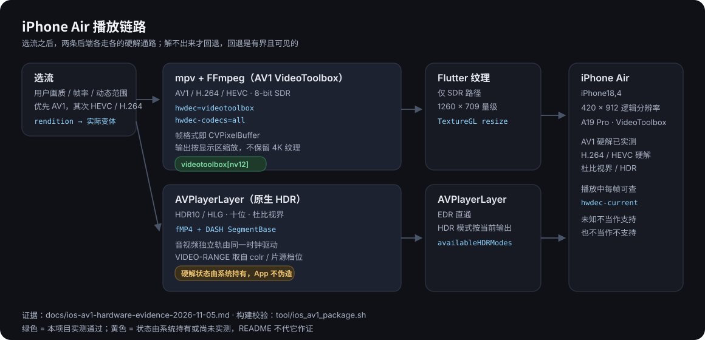

<div align="center">
    
    <h1>PiliPlus</h1>
    <p><b>A third-party Bilibili client tuned for iPhone Air</b></p>
    <p>AV1 / HEVC / H.264 hardware decoding · HDR10 / HLG · Dolby Vision</p>

[中文](README.md) | English


<br/>

<br/>
</div>

<br/>

## What this branch is about

One thing: **make iPhone Air decode video on the hardware it has**, and be honest
when it cannot.

Four separate facts have to hold, and they used to be collapsed into one:

1. the chip can — VideoToolbox reports AV1 support;
2. **the build can** — the FFmpeg shipped inside the app registers `av1_videotoolbox`;
3. the rendition is chosen correctly — an AV1 variant that can be decoded, without
   overriding the codec order you set yourself;
4. the session really is decoding in hardware — `hwdec-current=videotoolbox`, and
   the frame format is the `CVPixelBuffer` itself.

When (2) was false the app still said AV1 was available and decoded 3840×2160 on
the CPU; the only visible symptom was heat and dropped frames. That cannot happen
silently any more: **a build without the decoder fails to build**.

<br/>

## Hardware decoding and HDR

| Capability | Path | Status |
| --- | --- | --- |
| AV1 8-bit SDR | mpv + FFmpeg + VideoToolbox | ✅ measured on device (4K60 / 4K30) |
| HEVC / H.264 | mpv + VideoToolbox | ✅ measured, including a 4K60 regression run |
| HDR10 / HLG | AVPlayerLayer (native HDR) | ✅ native path, never downgraded to 8-bit SDR |
| Dolby Vision | AVPlayerLayer, RPU applied by the system | ✅ routed natively instead of being demoted |
| AV1 10-bit | AVPlayerLayer | ▶️ plays correctly; its hardware state is recorded as `unavailable` |

**Measured on iPhone Air (iPhone18,4, iOS 27.3, diagnostic build):**

| Source | Rendition | Samples | Hardware |
| --- | --- | --- | --- |
| AV1 | 3840×2160 @60fps `av01.0.13M.08` | 31 | 31 |
| AV1 | 4096×2160 @59.994fps `av01.0.13M.08` | 32 | 32 |
| AV1 | 3840×2024 @59.932fps `av01.0.13M.08` | 32 | 32 |
| AV1 | 3840×2160 @29.97fps `av01.0.13M.08` | 2 | 2 |
| H.264 | 3840×2160 @60fps (regression) | 13 | 13 |

The evidence is not "we asked for `hwdec=videotoolbox`": it is the per-frame
`hwdec-current=videotoolbox` the player reports, plus libmpv's
`vd: Decoder format … videotoolbox[nv12]`, which says the frames arriving are
VideoToolbox pixel buffers rather than CPU frames uploaded afterwards.

Full evidence, build identity and the list of unmeasured cases:
[docs/ios-av1-hardware-evidence-2026-11-05.md](docs/ios-av1-hardware-evidence-2026-11-05.md).

<br/>



<br/>

## Why iPhone Air

- **AV1 first**: smaller than HEVC at the same quality, and on this device it is
  decoded by VideoToolbox instead of the CPU.
- **Two backends, each doing its job**: 8-bit SDR goes through mpv (danmaku,
  subtitles, speed, super resolution), HDR / 10-bit / Dolby Vision goes through
  AVPlayerLayer for real EDR passthrough.
- **Output sized to the screen**: a 4K source no longer allocates a 3840×2160
  Flutter texture; the player settles around 1260×709.
- **Layout measured at 420 × 912**: dialogs, danmaku, episode and quality panels
  were checked one by one at that logical size.
- **Capabilities reported honestly**: system, build, backend and session are four
  separate answers, and "unknown" is treated as neither yes nor no.

<br/>

## Build and verify (iOS)

Requires Flutter 3.47.9, Xcode 27.x and an Apple Development certificate.

```bash
# Signed release: injects the AV1 VideoToolbox decoder, verifies it, re-signs
PILIPLUS_DEVELOPMENT_TEAM=XXXXXXXXXX tool/ios_build.sh release

# Verify an artefact: decoder identity, export set, dependencies, diagnostics
tool/verify_release_constraints.sh build/ios/iphoneos/Runner.app
```

`tool/ios_av1_package.sh` is the single implementation shared by every build
entry point. After replacing `Avcodec.framework` it checks the Mach-O UUID (which
re-signing cannot change), the full exported symbol set (not a count), the
dependent libraries, and that a device slice did not end up in a simulator
bundle. Any failure stops the build.

<br/>

## Platforms

- [x] iPhone Air (primary target, measured item by item)
- [x] iOS / iPadOS
- [x] Android
- [x] Windows
- [x] Linux

<br/>

## Features


- Playback: gesture seek, brightness/volume, fullscreen, speed, danmaku,
  subtitles, resume, aspect modes, super resolution, HDR/Dolby Vision passthrough
- Quality and codec selection, audio quality selection, hardware decoding
  (AV1 / HEVC / H.264 depending on device and source)
- Home, ranking, live, bangumi, search, video detail, comments, dynamics
- Offline cache, watch later, history, favourites, multi-account, WebDAV backup
- SponsorBlock, high-energy progress bar, skip intro/outro, Live Photo, notes

<br/>

## Download

Download a build from [Releases](https://github.com/bggRGjQaUbCoE/PiliPlus/releases),
or clone the repository and build it locally. iOS builds need your own signing
identity; this repository ships no certificate, profile or credential.

<br/>

## Disclaimer

PiliPlus is a personal project developed for educational purposes, intended only for learning and testing. Please delete it within 24 hours of downloading.
All APIs used were collected from the official website. This project does not provide any cracked content.

Credit to the original project: [guozhigq/pilipala](https://github.com/guozhigq/pilipala).
Credit to the upstream project: [orz12/PiliPalaX](https://github.com/orz12/PiliPalaX).
This repository makes more extensive changes. Thank you to the original authors for sharing their work as open source.

<br/>

## Credits

- [bilibili-API-collect](https://github.com/SocialSisterYi/bilibili-API-collect)
- [flutter_meedu_videoplayer](https://github.com/zezo357/flutter_meedu_videoplayer)
- [media-kit](https://github.com/media-kit/media-kit)
- [melodink-libmpv-darwin-build](https://github.com/gungun974/melodink-libmpv-darwin-build)
- [FFmpeg](https://ffmpeg.org/) · [mpv](https://mpv.io/)
