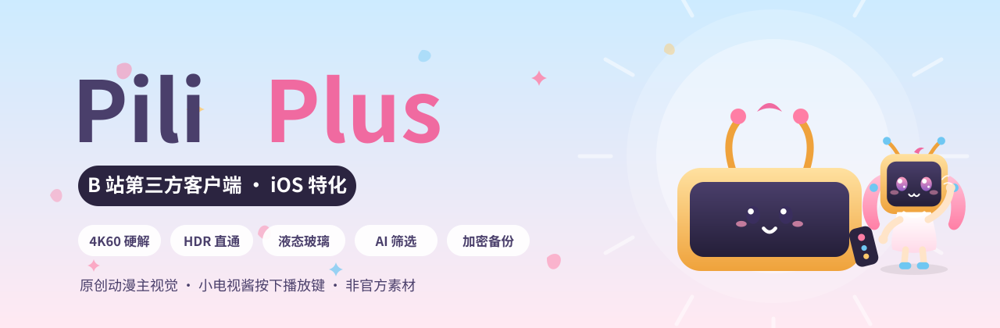
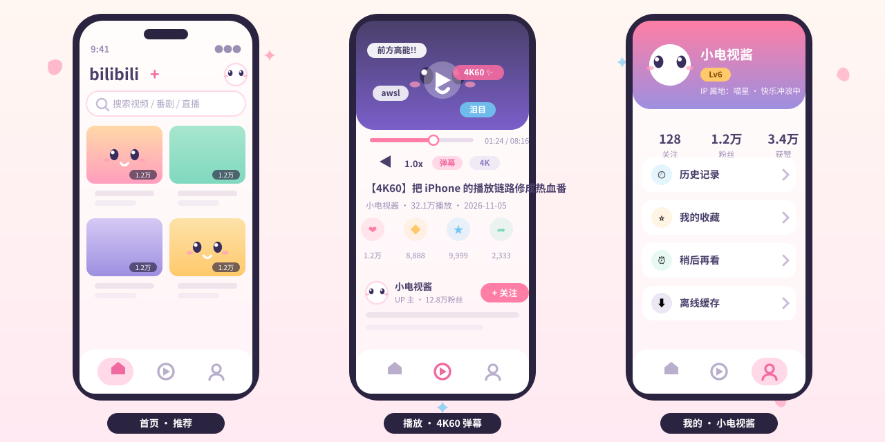
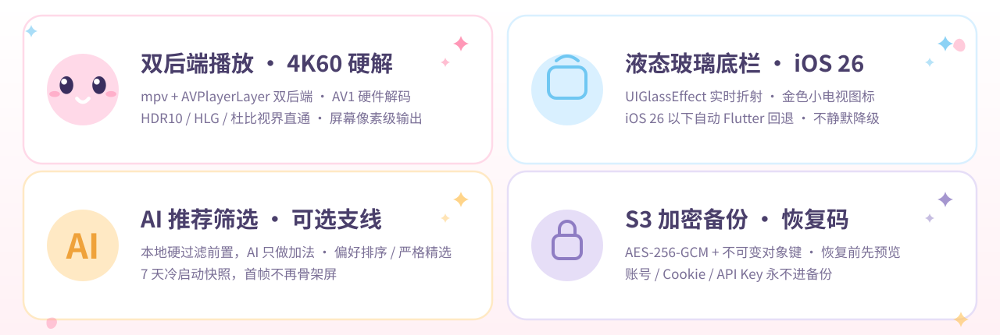
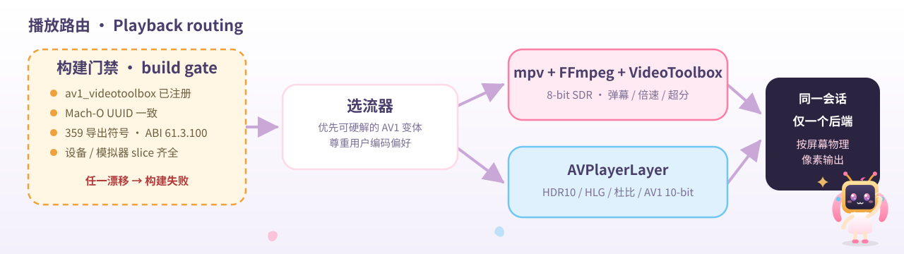
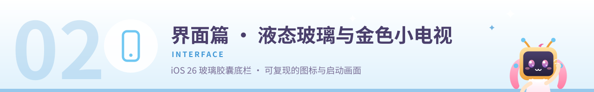
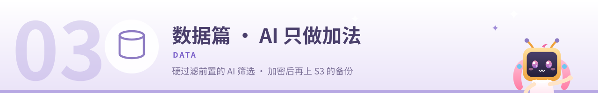
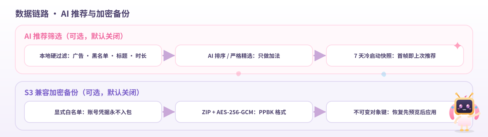

<div align="center">



# PiliPlus ✨

**B 站第三方客户端 · iOS 特化版**

在上游 [PiliPlus](https://github.com/bggRGjQaUbCoE/PiliPlus) 的基础上，围绕 iPhone 真机把三件事做到位：
**播放链路**（AV1 4K60 硬解 · HDR 直通）、**原生界面**（液态玻璃底栏 · 可复现图标）、**数据安全**（AI 筛选 · 加密备份）。

&nbsp;&nbsp;&nbsp;

[功能亮点](#-功能亮点) · [安装](#-安装) · [使用与配置](#-使用与配置) · [构建与验证](#-构建与验证) · [文档索引](#-文档索引) · [参与贡献](#-参与贡献)

</div>

> [!IMPORTANT]
> **这是一个 iOS 特化分支。** Android / Windows / Linux / macOS 的构建目标与流水线已在本分支移除，只维护 iOS 真机体验；需要全平台支持请回到[上游仓库](https://github.com/bggRGjQaUbCoE/PiliPlus)。本项目为非官方作品，与 bilibili 官方无关，仅供学习交流。

## 📺 简介

PiliPlus 源自 PiliPalaX / PiliPlus 一系的 bilibili 第三方客户端，继承了上游完整的社区功能：推荐 / 热门 / 排行、搜索、视频详情与评论、弹幕 / 字幕 / 倍速 / 画质、动态 / 直播 / 私信 / 收藏 / 历史 / 稍后再看 / 离线缓存、多账号、WebDAV、SponsorBlock、高级弹幕、片段与 LivePhoto 等。

本分支在此基础上做 **iOS 特化**：

- **播放**：自建双后端播放链路，AV1 4K60 走 VideoToolbox 硬解，HDR 片源走系统原生直通，构建期用"闸门"保证解码器真的在包里；
- **界面**：iOS 26 液态玻璃胶囊底栏，附 Flutter 回退；金色小电视图标与启动画面由脚本字节级复现；
- **数据**：硬过滤前置的可选 AI 推荐筛选，以及"先加密再上云"的 S3 兼容备份与恢复码。

当前版本 `v0.0.6+7`，基于 Flutter 3.47.9（Dart ≥ 3.13.0），仅面向 **iOS 15.0+**。

## 🖼️ 预览

<div align="center">

</div>

> 以上为原创动漫示意图（小电视酱友情出镜），非真实截图 —— 界面细节以实际构建为准。

## ✨ 功能亮点

<div align="center">

</div>

### EP.01 播放篇

<div align="center">

</div>

- **按片源特性分派后端**：8-bit SDR 交给 `mpv + FFmpeg + VideoToolbox`（弹幕、倍速、超分全功能）；HDR10 / HLG / 杜比视界 / AV1 10-bit 交给 `AVPlayerLayer` 走 EDR 直通。同一会话只用一条后端，切换时明确交接。
- **AV1 4K60 硬解 + 构建闸门**：构建时注入 `av1_videotoolbox`，并校验注册状态、Mach-O UUID、359 个导出符号、ABI 61.3.100、device / simulator 双切片 —— 任何漂移直接让构建失败，而不是运行时黑屏。
- **选流器尊重硬件能力**：优先挑选可硬解的 AV1 分辨率档位，同时尊重用户的编码器偏好设置。
- **屏幕像素级输出**：输出尺寸按屏幕物理像素计算（iPhone Air 16:9 ≈ 1260×709），120ms 防抖跟随；开启 Anime4K 超分或关闭硬解时保持源尺寸。
- **状态可解释**：`PlaybackCapabilities` / `PlaybackRoute` 实时报告 preparing / native / disposed / none 状态与中文原因，出问题时一眼看懂。

<div align="center">

</div>

### EP.02 界面篇

<div align="center">

</div>

- **液态玻璃底栏（iOS 26+）**：原生 `UIGlassEffect(style: .clear)` 实时折射下方内容；52pt 高的玻璃胶囊（最长 360pt、边距 30pt、圆角 26），选中块 82×36 / r18，三个无文字入口，支持点击与拖拽交互。
- **优雅回退**：iOS 26 以下自动切换 Flutter 实现（BackdropFilter + 着色 shader），日志输出 `[native-glass] Flutter fallback: <原因>`，行为可追溯。
- **无障碍**：为 VoiceOver 与"减少透明度"预留语义字段，底栏行为可被系统设置接管。
- **金色小电视图标**：`design/app_icon/master-2048.png` 单一源文件 → `tool/app_icon/render_icon.py`（SDF 光线步进 + GGX + ACES 色调映射）→ `build_assets.py` 字节级可复现输出；启动画面同步生成（LaunchImageGoldTV）。

### EP.03 数据篇

<div align="center">

</div>

**AI 推荐筛选（可选，默认关闭）**

- **硬过滤前置**：广告识别、黑名单、标题正则、时长、点赞率、关注豁免等本地规则先跑，AI 只对幸存结果重排 / 折叠 —— **不能复活任何被过滤的视频**。
- **两种模式**：偏好排序（温和重排）/ 严格精选（不够好就折叠）。
- **隐私边界**：独立 Dio 实例，不带 Cookie / CSRF / access_key，仅 HTTPS 公开接口、禁重定向。
- **预算控制**：每批 20 条候选 × 每次刷新 2 批，每日上限 100 次，首屏预算 2 秒。
- **冷启动快照**：40 可见 + 20 折叠存入 Hive（`localCache` → `aiFeedSnapshot`），TTL 7 天、按账号隔离，重装 / 冷启不再骨架屏。

**S3 兼容加密备份（可选，默认关闭）**

- **先加密再上云**：ZIP 打包后 AES-256-GCM 加密（`PPBK` 格式头，每次加密使用新 nonce）。
- **不可变对象键**：`<prefix>/v1/<backupSetId>/<deviceId>/<UTC>-<snapshotId>.ppbackup`，配合 `If-None-Match: *` 防覆盖。
- **恢复码**：`PPB1-` 前缀 Base32 + 校验位，256 位密钥存 Keychain；换机只凭恢复码即可还原。
- **恢复先预览**：RestorePlanner 先给出应用计划再执行，全程按日志可回滚；账号 / Cookie / API Key / S3 凭据**永不进入备份包**。

**分享区修复**：纯文本分享（`EN_MSG_TYPE_TEXT`）中用 `BV[0-9A-Za-z]{10}` 提取 BV 号；先过滤后去重（`foldForWanted()`）；标题经 `VideoHttp.videoIntro` 补全。

<div align="center">

</div>

## 📦 安装

### 方式一 · 下载现成 IPA

前往 [Releases](https://github.com/devzer0o0/BilibiliPlus/releases) 下载最新 IPA，用你惯用的自签工具（AltStore / Sideloadly / TrollStore 等）安装到设备。

### 方式二 · 从源码构建

**环境要求**：Flutter 3.47.9（ Dart ≥ 3.13.0）· Xcode 27.x · Apple Developer Team ID · iOS 15.0+ 真机

```bash
git clone https://github.com/devzer0o0/BilibiliPlus.git
cd BilibiliPlus
flutter pub get
PILIPLUS_DEVELOPMENT_TEAM=XXXXXXXXXX tool/ios_build.sh release
```

构建产物在 `build/ios/iphoneos/Runner.app`；需要直接产出 IPA 时使用 `tool/ios_av1_package.sh`（唯一的共享构建入口，会自动完成 AV1 解码器注入与校验）。

## 🎛️ 使用与配置

两大增值功能都在应用内设置中，**默认关闭、按需开启**：

| 功能 | 入口 | 要点 |
| --- | --- | --- |
| AI 推荐筛选 | 设置 → 推荐相关 | 开启后选「偏好排序 / 严格精选」；规则过滤永远先行 |
| S3 兼容备份 | 设置 → 备份 | 填写 S3 凭据后先「生成恢复码」再开启自动备份 |

细节、隐私边界与恢复流程见 [docs/ai-recommend-and-s3-backup.md](docs/ai-recommend-and-s3-backup.md)。

## 🔨 构建与验证

<div align="center">

</div>

```bash
# 发布约束校验（签名 / 解码器 / 产物结构）
tool/verify_release_constraints.sh build/ios/iphoneos/Runner.app

# 六段回归（播放 / 界面 / 数据 / 分享 / 图标 / 构建），非零退出即失败
tool/full_regression.sh
```

CI（`.github/workflows/ios.yml`）固定执行：**flutter test → 构建 → 注入 AV1 解码器 → 校验产物 → 打包 IPA**，与本地一条命令等价。

## 🗂️ 仓库结构

| 目录 | 内容 |
| --- | --- |
| `lib/` | Flutter 业务代码与播放链路（后端分派 / 选流器 / 能力上报） |
| `ios/` | 原生壳：AVPlayerLayer 通道、液态玻璃底栏、启动画面 |
| `tool/` | 构建、校验、回归、图标渲染脚本 |
| `test/` | 单元测试与六段回归 |
| `docs/` | 设计文档与真机验证记录 |
| `design/app_icon/` | 金色小电视图标源文件 |
| `.github/workflows/` | iOS CI 流水线 |

## 🗺️ 路线图

**已完成**

- [x] AV1 4K60 硬件解码 + 构建期闸门
- [x] 原生液态玻璃底栏（iOS 26）+ Flutter 回退
- [x] 字节级可复现的金色小电视图标与启动画面
- [x] 可选 AI 推荐筛选 + 7 天冷启动快照
- [x] S3 兼容加密备份 + 恢复码恢复

**进行中 / 计划**

- [ ] HDR10 屏幕合成（当前直通输出）
- [ ] HLG / 杜比视界片源接入
- [ ] 原生画中画真机验证
- [ ] S3 备份真机端到端
- [ ] 深色玻璃 / VoiceOver / 无障碍细节
- [ ] 上游功能回归保护

> 证据图例：✅ 真机 / 产物已验证 · 🟡 自动化已验证 · ▶️ 已实现未跑 · ⛔ 未验证

## 🤝 参与贡献

欢迎 Issue 与 PR：

- 改动**播放链路**请附上 `tool/full_regression.sh` 的输出；
- 改动**界面 / 图标**请保持可复现管线，不要手工替换生成产物；
- 涉及新行为的改动，建议在 `docs/` 下留一份简短的验证记录。

## 📚 文档索引

| 文档 | 内容 |
| --- | --- |
| [docs/ios-native-playback-architecture.md](docs/ios-native-playback-architecture.md) | 双后端播放架构与选流策略 |
| [docs/ios-av1-hardware-evidence-2026-11-05.md](docs/ios-av1-hardware-evidence-2026-11-05.md) | AV1 硬解能力与构建闸门证据 |
| [docs/liquid-glass-bottom-bar.md](docs/liquid-glass-bottom-bar.md) | 液态玻璃底栏设计与回退行为 |
| [docs/app-icon-and-launch-screen.md](docs/app-icon-and-launch-screen.md) | 图标 / 启动画面复现管线 |
| [docs/ai-recommend-and-s3-backup.md](docs/ai-recommend-and-s3-backup.md) | AI 筛选与 S3 备份设计 |
| [docs/home-shared-videos.md](docs/home-shared-videos.md) | 首页共享视频流改造 |

## 📄 许可与致谢

本项目以 [GPL-3.0](LICENSE) 协议开源。与 bilibili 官方无关，不提供任何官方服务，仅供学习交流。

感谢这些让本项目得以存在的项目：[PiliPlus](https://github.com/bggRGjQaUbCoE/PiliPlus)（上游）· [PiliPalaX](https://github.com/PiliPalaX/PiliPalaX) 与 [pilipala](https://github.com/guozhigq/pilipala)（前身）· [bilibili-API-collect](https://github.com/SocialSisterYi/bilibili-API-collect) · [media-kit](https://github.com/media-kit/media-kit) · FFmpeg / mpv · dio · [My-Responsitories](https://github.com/My-Responsitories)。

<div align="center">


<sub>PiliPlus · iOS 特化 · 下一话 4K60 见 ✨</sub>

</div>
