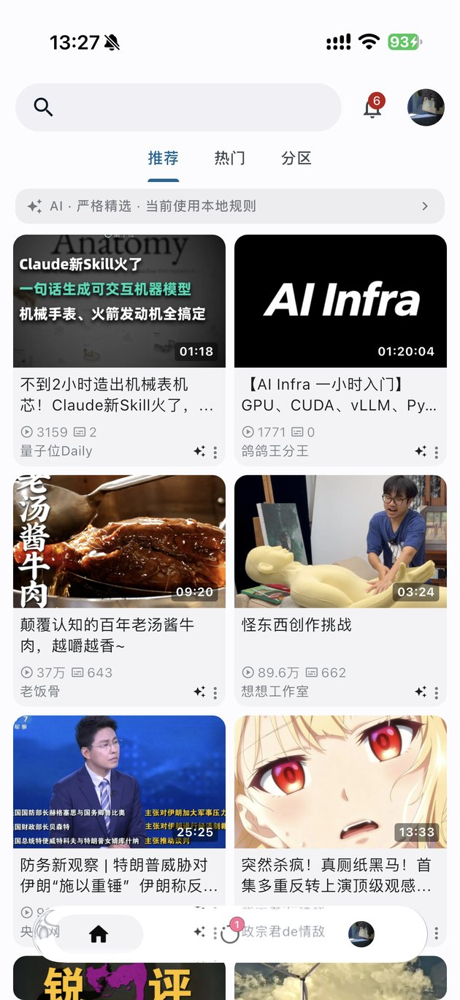
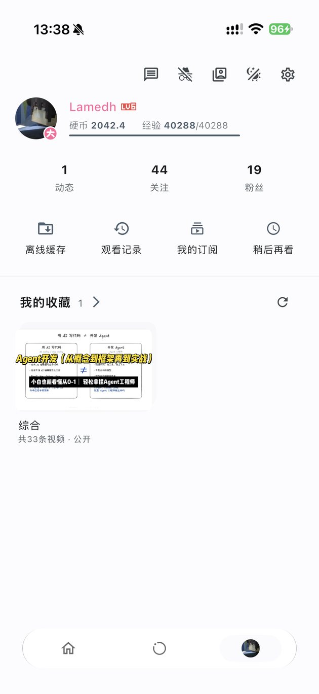

  <h1>Bilibili+</h1>
  
<b>把 iPhone Air 的播放链路拆开、修好，并留下证据的 B 站第三方客户端</b>

  
基于 <a href="https://github.com/bggRGjQaUbCoE/PiliPlus">PiliPlus</a> 的 iOS 分支 · GPL-3.0 · 0.0.4+5

  
<a href="https://github.com/devzer0o0/BilibiliPlus/releases">下载</a> · <a href="README.en.md">English</a>

> 这个 README 只写**本仓库实际改过、并且拿得出证据**的部分。上游已经有的功能不在这里重复；没有验证的项目会明确写“未验证”，不用“应该可以”代替。

## 这个分支改了什么

上游 PiliPlus 是一个功能完整的 B 站客户端。这个分支的重心是 iOS 播放链路，但不是只改播放：

| 领域 | 上游 | 本分支 | 状态 |
| --- | --- | --- | --- |
| 播放后端 | mpv 单后端 | mpv + AVPlayerLayer 双后端；HDR10 / 10-bit 走原生，杜比视界按同一路径接入 | ✅ HDR10 真机 |
| AV1 硬解 | FFmpeg 默认不带 AV1 VideoToolbox | 注入 `av1_videotoolbox`，构建时校验 UUID、导出符号、依赖 | ✅ 真机 4K60 |
| 能力上报 | 请求成功就当作支持 | 系统 / 构建 / 后端 / 会话四级；拒绝带原因 | ✅ 自动化 + 真机 |
| 输出尺寸 | 按片源分辨率分配纹理 | 按显示区物理像素分配，120 ms 防抖 | ✅ 单测 + 真机 |
| 底栏 | Flutter 材质 | iOS 26 原生 `UIGlassEffect` 胶囊，低版本回退 | ✅ 真机材质 / 点击 |
| 图标 / 启动图 | 旧图换色 | SDF 重绘金色小电视；母版到资源的可重复管线 | ✅ 产物 + 真机安装 |
| 推荐流 | 规则过滤 | 可选 AI 语义筛选 / 排序，本地画像 | 🟡 单测 / 构建 |
| 备份 | 本地 / WebDAV | S3 兼容 + AES-256-GCM + 恢复码 | 🟡 逻辑 + MinIO 连接 |
| 分享区 | — | 纯文本分享、过滤顺序、标题三个修复 | ✅ 日志 + 单测 |
| 平台 | iOS / Android / Windows / Linux | 只保留 iOS 工程 | ✅ 目录 / CI |

图例：✅ 有真机或产物证据；🟡 自动化 / 模拟器 / 局部服务验证；▶️ 已实现但未真机运行；⛔ 未验证。后文按这个标准写。

## 播放：把“支持 AV1”拆成四个事实

“芯片支持 AV1”不等于“这个 App 在用硬件解 AV1”。本分支要求四件事同时成立：

1. **芯片能解** — VideoToolbox 报告支持 AV1；
2. **构建里真的有解码器** — 打包进 App 的 FFmpeg 注册了 `av1_videotoolbox`；
3. **选流选对了** — 优先挑能硬解的 AV1 变体，同时尊重你自己的编码偏好；
4. **会话确实在硬解** — 播放器每帧回报 `hwdec-current=videotoolbox`，帧格式是 `CVPixelBuffer`。

以前第 2 条不成立时，App 仍会说 AV1 可用，然后用 CPU 解 3840×2160：表现是发热、掉帧，日志里看不出问题。现在 `tool/ios_av1_package.sh` 在替换 `Avcodec.framework` 后核对：

- **Mach-O UUID** — 重签名改不了它，能区分“我们的解码器”和 pod 自带的；
- **完整导出符号集合** — 不是数个数，是逐个比对（ABI 61.3.100，359 个导出）；
- **依赖库** — ABI 期望的库一个不多一个不少；
- **设备 / 模拟器 slice** — 真机二进制不会被塞进模拟器包。

任何一项不成立，构建失败。**缺解码器就不给构建**，不留静默降级的口子。

### 能力与实测

| 能力 | 路径 | 状态 |
| --- | --- | --- |
| AV1 8-bit SDR | mpv + FFmpeg + VideoToolbox | ✅ 真机实测硬解（4K60 / 4K30） |
| HEVC / H.264 | mpv + VideoToolbox | ✅ 真机实测硬解（含 4K60 回归） |
| HDR10 | AVPlayerLayer（原生 HDR 直通） | ✅ 真机选中 Main10 / PQ 变体并出画；屏幕 HDR 合成未验证 |
| HLG | AVPlayerLayer | ▶️ 路由已接入；本轮没有 HLG 片源 |
| 杜比视界 | AVPlayerLayer + RPU 由系统还原 | ▶️ 路由已接入；采样片源未出现 `dvh1`，未实测 |
| AV1 10-bit SDR | AVPlayerLayer | ✅ 真机截图画面正确、无绿屏；硬解状态记 `unavailable`，不伪造 |

**实测记录（iPhone Air，iPhone18,4，iOS 27.3，签名 Release 之前的诊断构建）**

| 片源 | 规格 | 采样 | 硬解 |
| --- | --- | --- | --- |
| AV1 | 3840×2160 @60fps `av01.0.13M.08` | 31 | 31 |
| AV1 | 4096×2160 @59.994fps `av01.0.13M.08` | 32 | 32 |
| AV1 | 3840×2024 @59.932fps `av01.0.13M.08` | 32 | 32 |
| AV1 | 3840×2160 @29.97fps `av01.0.13M.08` | 2 | 2 |
| H.264 | 3840×2160 @60fps（回归） | 13 | 13 |

判定依据不是“我请求了 `hwdec=videotoolbox`”，而是播放器每帧回报的 `hwdec-current=videotoolbox`，以及 libmpv 的 `vd: Decoder format … videotoolbox[nv12]`：后者说明收到的帧**就是** VideoToolbox 的 `CVPixelBuffer`，不是先解到 CPU 再上传。

完整证据、构建身份、未测范围见 [docs/ios-av1-hardware-evidence-2026-11-05.md](docs/ios-av1-hardware-evidence-2026-11-05.md)。

### 两条后端，一条时间线

- **8-bit SDR 走 mpv**：弹幕、字幕、倍速、超分、截动图这些功能都在。
- **HDR10 / HLG / 杜比视界 / AV1 10-bit 走 AVPlayerLayer**：真正的 EDR 直通，不把 HDR 压成 SDR 再假装；各格式的验收状态见上表。
- 同一会话只有一个后端；切源时旧后端先 dispose，不会两个后端同时开着、只隐藏一个。
- 位置、时长、播放状态来自同一个 snapshot；媒体代次只由门面分配一次，旋转、全屏、控制条显隐不产生新代次。
- 原生路径没有的能力（切音轨、动态截图、超分、播放器音量、AirPlay 视频）统一走 `PlaybackCapabilities` + `PlaybackRoute`，按 `preparing / native / disposed / none` 状态返回中文原因，不静默失败。

完整架构与证据等级见 [docs/ios-native-playback-architecture.md](docs/ios-native-playback-architecture.md)。

### 输出按屏幕，不按片源

4K 片源不再让 Flutter 纹理按 3840×2160 分配。播放器按显示区的物理像素分配输出：iPhone Air 全宽 16:9 稳定在 **1260×709** 量级；DPR、BoxFit 裁切/拉伸、显式比例、旋转、窗口变化、手势缩放都参与计算，上限是片源尺寸。120 ms 防抖与串行化原生命令避免连续拖动时反复重建；Anime4K 开启或硬解关闭时保留完整片源输出。

这段逻辑位于共享播放层，覆盖 media-kit 的 iOS / macOS / Windows / Linux 后端（本分支只构建 iOS）；Android 不走这条路径，它的 surface 尺寸变更会重新初始化 mpv 输出。Windows 每次 resize 会有至少一帧闪动，这是固定版本插件的已知代价，本项目接受它来换 4K 片源更小的输出缓冲。

## 液态玻璃底栏（本分支重做）

移动端底栏参考录屏里的液态玻璃胶囊：首页 / 动态 / 我的三个入口、无文字、图标居中、选中项背后一块浅色胶囊。页面切换、回顶刷新、动态角标、头像与安全区仍由原有控制器负责。

  
  

*图 1（左）：首页。底部胶囊不是截图贴图，而是 iOS 26 的 `UIGlassEffect`；滚动时它实时采样下方内容。图 2（右）：“我的”页，选中块落在头像入口。两张均为 iPhone Air 真机截图。*

- **iOS 26 及以上**：`UIVisualEffectView` + `UIGlassEffect(style: .clear)`，`isInteractive = true`，胶囊高 52 pt、最大宽 360 pt、左右边距 30 pt、圆角 26；选中块 82×36，圆角 18。Flutter 只负责页面、业务状态、外层布局和无障碍标签，原生视图负责材质、三个按钮、选中块、角标和命中测试。
- **iOS 26 以下 / 非 iOS / 能力查询失败 / 平台视图 3 秒内未创建**：走 Flutter 回退（BackdropFilter + shader），日志打印 `[native-glass] Flutter fallback: <原因>`。支持原生的设备不允许静默回退后仍按原生验收。
- **无障碍与偏好**：VoiceOver 的按钮标签、选中态、未读数都有对应字段；降低透明度、提高对比度、减少动态效果各有处理路径。键盘弹出时底栏退出布局、命中与语义。
- **已验证**：真机材质日志 `material=UIGlassEffect.clear`、三入口点击、滚动时胶囊内亮度随内容变化（111→235→252→118）、进入视频详情页后胶囊消失、返回恢复。
- **未验证**：深色主题真机表现、按压动效体感、VoiceOver、降低透明度 / 提高对比度、键盘、旋转、前后台恢复、内存与帧率。

细节、桥接协议与真机验收步骤见 [docs/liquid-glass-bottom-bar.md](docs/liquid-glass-bottom-bar.md)。

## 金色小电视图标与启动画面（本分支重做）

上一版图标是“bilibili 国际版官方图标只换颜色”（金黄底 + 白色字标 + 左上角地球）。这次按 B 站百万粉丝纪念奖牌中央的**金色小电视**重绘：宽圆角矩形机身、双天线、内凹屏框、浮雕眼嘴；没有字标、地球、底脚、旋钮或文字。

  

*图 3：图标不是“旧图换个色”。左边是上一版；右边是按奖牌中央小电视重绘的版本，金属反射、倒角和屏框阴影都由几何与光照生成。*

- **设计母版**：`design/app_icon/master-2048.png`（2048²）是唯一定义源；1024 图标与透明小电视素材由它派生，母版不会被反向覆盖。
- **生成方式**：`tool/app_icon/render_icon.py` 用 SDF 光线步进（机身 / 天线 / 眼睛）+ 前表面高度场浮雕（屏面 / 嘴唇）+ 程序化棚拍环境 + GGX + ACES 渲染；没有用图像生成模型，所有形状参数都是可编辑常量。
- **可重复管线**：`tool/app_icon/build_assets.py` 每次从三张母版重新采样，生成 iOS AppIcon 全尺寸、启动图、logo、ICO 与 Android 前景；ICC 时间戳固定，同输入逐字节同输出（两次完整运行的 SHA-256 一致）。
- **验收**：25 条 AppIcon 引用 / 21 个唯一文件，20–1024 尺寸逐项匹配；1024 图标 RGB、无 alpha、内嵌 sRGB；60 px 下仍能辨认金色小电视与天线；`actool` 编译通过。

启动画面保持黑底 + 居中的透明金色小电视。iOS 会缓存 launch storyboard 的快照，只换图片可能继续显示旧图，所以启动图资源从 `LaunchImage` 改名为 **`LaunchImageGoldTV`**，build 号提到 **0.0.3+4**；覆盖安装后 `Library/SplashBoard` 下 4 个快照全部重建，旧快照消失。

  

*图 4：冷启动画面。这是模拟器截图，不是真机启动画面证据；真机侧的间接证据是 SplashBoard 快照重建与 `Assets.car` 中只剩 `LaunchImageGoldTV`。*

完整设计来源、材质参数、资源清单与验收记录见 [docs/app-icon-and-launch-screen.md](docs/app-icon-and-launch-screen.md)。

## AI 推荐筛选（本分支新增）

AI 是**可选层**，默认关闭。它接在现有硬过滤之后：广告、黑名单、标题正则、发布时间、时长、点赞率、关注豁免仍由 `RecommendFilter` 先执行；AI 只给已经通过的候选打分、排序或折叠，**不能把删掉的条目放回来**。

- **两种模式**：`偏好排序`只调整顺序，高置信度“少看”主题可折叠并在状态栏恢复；`严格精选`只删除模型实际评分且低于阈值的内容，未评分内容保留。模型不可用时状态显示“当前使用本地规则”，不伪装成严格精选。
- **排序**：综合语义相关性、本地画像/关键词、明确想看/少看、新鲜度、B 站原顺序和作者偏好；缺失的评分不按 0 分处理，只对已知分量重新归一化。探索位约占 20%，同一作者连续出现时做一次相邻降权，软约束不突破硬过滤。
- **请求边界**：独立 Dio，不挂 B 站拦截器，不携带 Cookie / CSRF / access key / 设备头；默认只接受 HTTPS，loopback 或显式允许的私有网络地址可用 HTTP，公网 HTTP 始终拒绝；禁止重定向，避免 Authorization 被转发。API Key 只进平台安全存储。
- **预算与降级**：每批最多 20 个候选，每次刷新最多 2 批，每日默认 100 次；首屏等待预算 2 s，超时先用本地规则；后台预取下一页并使用更长的超时。刷新本身不发起模型请求，优先读取已准备好的结果。
- **冷启动快照**：每次成功展示后，把最多 40 条可见 + 20 条折叠的卡片字段、AI 分数/原因/折叠标记写入 Hive `localCache` 的 `aiFeedSnapshot`；启动时同步恢复，首帧就能看到上次推荐，不再先显示骨架屏。快照带账号作用域、来源和设置指纹，TTL 7 天；不匹配自动忽略。恢复成功后启动阶段**不再自动请求推荐**，页面保持快照内容并显示“使用缓存”；只有下拉刷新或快照缺失/不可用时才请求上游，刷新失败或超时保留可见内容。
- **隐私**：首次启用不自动读历史；导入需显式点击（最近 30 天、最多 200 条、只看 archive），账号不一致拒绝导入；暂停学习、匿名/无痕、初学者模式都会阻止写入；只保存内容偏好，不推断身份、健康、政治立场等敏感属性。

AI 的接入位置、排名权重、缓存键、降级语义与验证记录见 [docs/ai-recommend-and-s3-backup.md](docs/ai-recommend-and-s3-backup.md)。

## S3 兼容加密备份（本分支新增）

这是与原有本地 ZIP / WebDAV 并列的新链路，旧入口保持不变。默认关闭，配置在“设置 → S3 兼容备份”。

- **支持的服务**：AWS S3、Cloudflare R2、MinIO 等 S3 兼容端点；可选 path-style / virtual-hosted、Prefix、Region、超时、自动备份间隔与保留数量。
- **默认备份**：通用设置、界面与主题、播放与弹幕偏好、推荐过滤规则、本地黑名单、AI 明确偏好。**单独勾选且默认关闭**：AI 推测画像与反馈、搜索历史、本地历史评论、播放进度、自定义字体。
- **从不备份**：B 站账号 / Cookie / CSRF / access key / refresh token、AI API Key、S3 凭据、WebDAV 密码、恢复密钥、私信、缓存 / 日志 / 下载媒体。新增未知设置默认不进入备份，必须加入 `BackupRegistry` 的显式白名单。
- **对象与加密**：对象键为 `<prefix>/v1/<backupSetId>/<deviceId>/<UTC时间>-<snapshotId>.ppbackup`，不可变；上传用 `If-None-Match: *`，412/409 时先回读比对，不覆盖不同内容，没有可变的 `latest.json`。外层是 `PPBK` 头 + AES-256-GCM 密文，每次加密新 nonce；内层 ZIP 含 `manifest.json`、`data.json` 与可选 `font.bin`。
- **恢复码**：256 位随机恢复密钥默认存平台安全存储；恢复码形如 `PPB1-...`（Base32 + 校验字节），新设备填入同样的 S3 配置和恢复码即可解密对应 keyId 的快照。
- **恢复**：下载 / 解密 / 校验阶段不写现有设置；先由 `RestorePlanner` 预览分类变更、跳过项和是否需要重启，应用前写恢复日志，失败按日志回滚旧值。恢复 AI 偏好时强制 `enabled=false`，不会自动打开外部请求。
- **验证到哪**：加密往返、错钥、篡改、截断、路径穿越、归档版本、恢复规划与回滚等 44 项左右测试通过；MinIO 的 List / Put / Get / Delete 连接测试已验证；**完整备份上传到真实 S3、从真实 S3 恢复的端到端真机验收未做**，真机 Keychain 读写也未验证。

## 首页“分享给我的视频”（本分支修复）

首页推荐顶部会显示指定用户通过私信分享的视频。这条链路修了三个真实缺陷：

1. **纯文本分享被整条丢弃**：该用户发的是 `EN_MSG_TYPE_TEXT`，视频链接嵌在正文里，解析器只接受分享卡片，12 条消息匹配 0 条。新增正文 `BV[0-9A-Za-z]{10}` 提取，且回退仅限纯文本类型，直播/动态卡片不会被“复活”；解析数从 0 变为 11。
2. **去重与过滤顺序颠倒**：过滤曾放在“每个 bvid 保留最新副本”的去重之后，别人转发同一条视频就会把指定用户的副本顶掉，导致间歇性消失。现在过滤提前，抽成 `foldForWanted()`，生产代码与测试共用同一实现。
3. **标题显示成 URL**：链接独占一行、标题在上一行，初版取了链接自己那一行。现在优先取同行的非 URL 文本，该行只有链接时向上取最近的非空行，并剥掉 `1.` / `1、` / `1《` 这类编号；加载后再用 `VideoHttp.videoIntro` 补全真实标题与封面，查询失败保留原值而不是丢弃条目。

会话扫描窗口从 10 个扩到最多 40 个，并优先读取指定用户的会话，命中即停。测试覆盖纯文本解析、过滤顺序、标题与封面补全三个文件；详情见 [docs/home-shared-videos.md](docs/home-shared-videos.md)。

## 构建与验证

需要 **Flutter 3.47.9**、**Xcode 27.x**，以及一枚 Apple Development 证书。iOS 部署目标是 15.0。

~~~bash
# 签名 Release：自动注入 AV1 VideoToolbox 解码器、校验身份、重签
PILIPLUS_DEVELOPMENT_TEAM=XXXXXXXXXX tool/ios_build.sh release

# 只校验产物：解码器身份、导出符号集合、依赖库、诊断残留
tool/verify_release_constraints.sh build/ios/iphoneos/Runner.app

# 无真机也能跑的六段回归
tool/full_regression.sh
~~~

`tool/ios_av1_package.sh` 是所有构建入口（本地脚本、CI）共用的唯一实现；`tool/verify_release_constraints.sh` 还会检查 bundle id、AV1 ABI、导出符号和调试标记，任何一项漂移都会让构建失败。`tool/full_regression.sh` 把脚本自检、单元测试、Release 约束、实验脚手架扫描、HDR 选流门禁和 4K 精确性串在一起，失败即非零退出。

CI 在 `.github/workflows/ios.yml` 中执行 `flutter test`，然后构建、注入 AV1 解码器、校验产物并打包 IPA。仓库以前只构建不跑测试，这一步是本分支补上的。

## 平台、版本与边界

- **只保留 iOS**：本分支移除了 Android / Windows / Linux / macOS 的 runner；仓库里只剩资源或 Flutter 插件注册骨架。需要那些平台请使用上游 PiliPlus。所有验证围绕 iPhone Air 做，这是有意的取舍。
- **系统**：iOS 15.0+；原生液态玻璃需要 iOS 26+，低版本自动回退；HDR 原生路径从 iOS 15 起可用；AV1 硬解取决于芯片与片源。
- **主要目标设备**：iPhone Air（iPhone18,4），实测系统 iOS 27.3；Bundle ID 仍为 `com.example.pilipalax`，显示名 `bilibili+`。
- **继承上游**：动态、直播、私信、收藏夹、多账号、WebDAV、SponsorBlock、高级弹幕等功能仍在，但本分支没有逐项回归；这里不把它们写成“已验证”。
- **版本**：`0.0.4+5`。

## 日常功能（继承上游，未逐项回归）

这个分支没有重写日常客户端，下面这些仍然随包提供：

- 推荐 / 热门 / 分区、搜索、视频详情、评论与评论笔记
- 弹幕 / 字幕 / 倍速 / 画质与音质选择 / 记忆播放 / 超分辨率
- 动态 / 直播 / 私信 / 收藏夹 / 历史 / 稍后再看 / 离线缓存
- 多账号、WebDAV、SponsorBlock、高级弹幕、视频截取动图 / Live Photo

它们沿用上游实现；本分支的改动集中在播放、底栏、图标、AI 推荐筛选、S3 备份和首页分享区。完整功能清单以上游 README 为准。

## 还没有验证的部分

这张表是这份 README 的边界，不是待办清单的装饰：

| 项目 | 状态 | 原因 |
| --- | --- | --- |
| HDR 绿屏在 VideoToolbox 路径上是否被色调映射修复 | ⛔ | 模拟器无法复现；需要真机 HDR 片源逐帧比对 |
| HDR10 是否真正合成到屏幕；HLG / 杜比视界片源 | ⛔ | 真机只证明原生链路出画，未证明屏幕按 HDR 亮度呈现；后两者没有片源 |
| 深色液态玻璃、VoiceOver、降低透明度 / 提高对比度、帧率 | ⛔ | 真机未改辅助功能设置；xctrace 无法连接该设备 |
| 真机桌面图标与启动画面截图 | ⛔ | 启动画面消失快于截图延迟；只有快照重建与模拟器截图 |
| 原生 PiP、听视频、原生截图 | ▶️ | 代码与单测完成，真机 / 模拟器交互均未运行 |
| 真实 AI 模型服务 | ⛔ | 没有用户凭据；只有测试替身与本地服务 |
| 完整 S3 备份 / 恢复端到端 | ▶️ | MinIO 连接与对象往返已验证；完整链路未真机验收 |
| macOS / Windows / Linux / Android | ⛔ | 本分支不构建这些平台 |

## 下载与许可

从 [Releases](https://github.com/devzer0o0/BilibiliPlus/releases) 下载，或克隆仓库后按上文构建。iOS 需要自备签名；仓库不附带证书、描述文件或任何凭据。

代码以 **GPL-3.0** 发布。此项目仅用于学习和测试，请于下载后 24 小时内删除；所用 API 均从官方网站收集，不提供任何破解内容。

## 致谢

- 上游与前辈：[PiliPlus](https://github.com/bggRGjQaUbCoE/PiliPlus)、[PiliPalaX](https://github.com/orz12/PiliPalaX)、[pilipala](https://github.com/guozhigq/pilipala)
- [bilibili-API-collect](https://github.com/SocialSisterYi/bilibili-API-collect)
- [media-kit](https://github.com/media-kit/media-kit)、[melodink-libmpv-darwin-build](https://github.com/gungun974/melodink-libmpv-darwin-build)
- [FFmpeg](https://ffmpeg.org/)、[mpv](https://mpv.io/)、[dio](https://pub.dev/packages/dio)
- 多账号支持：[My-Responsitories](https://github.com/My-Responsitories)
