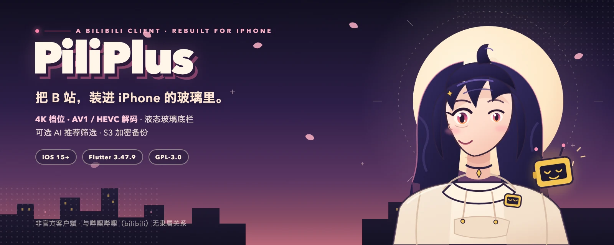
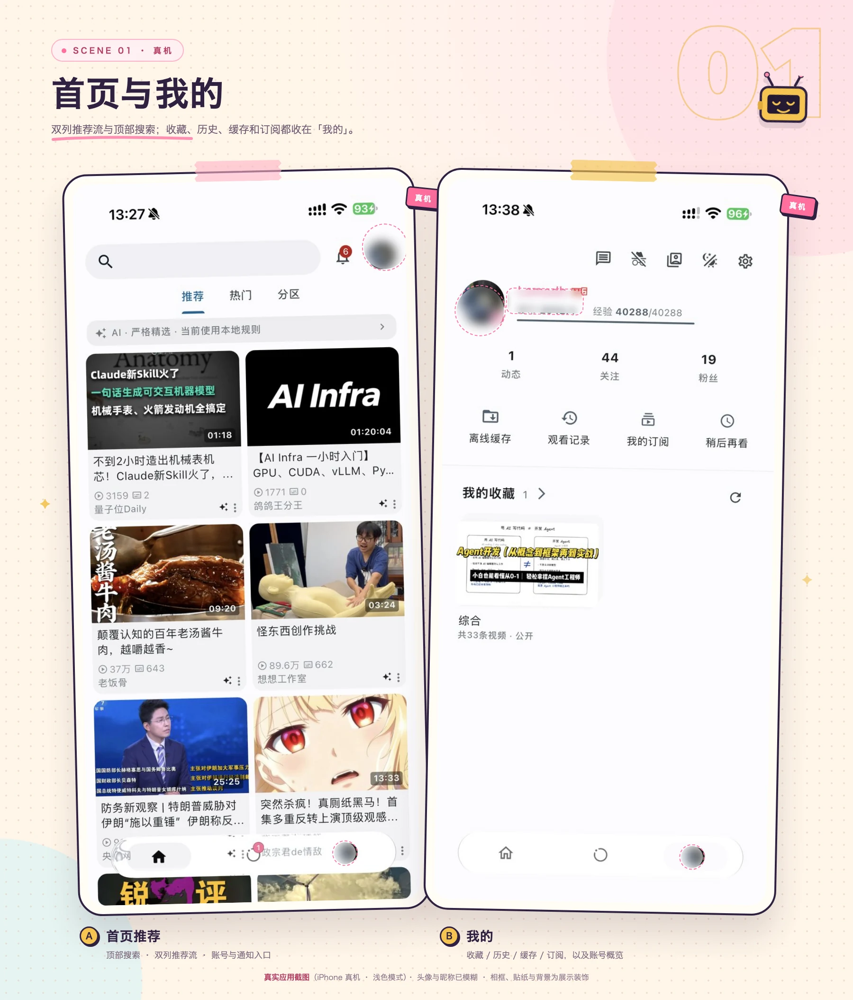
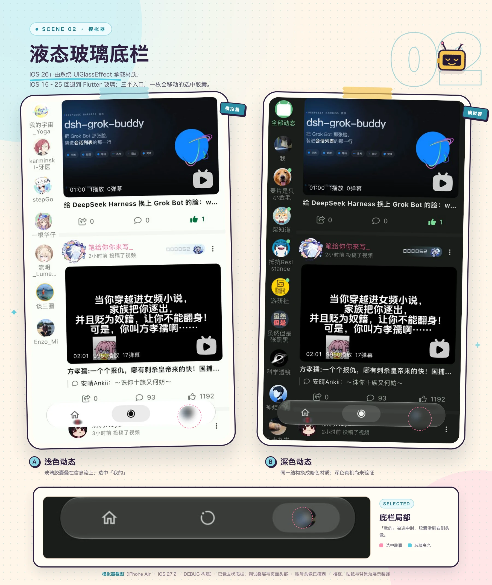
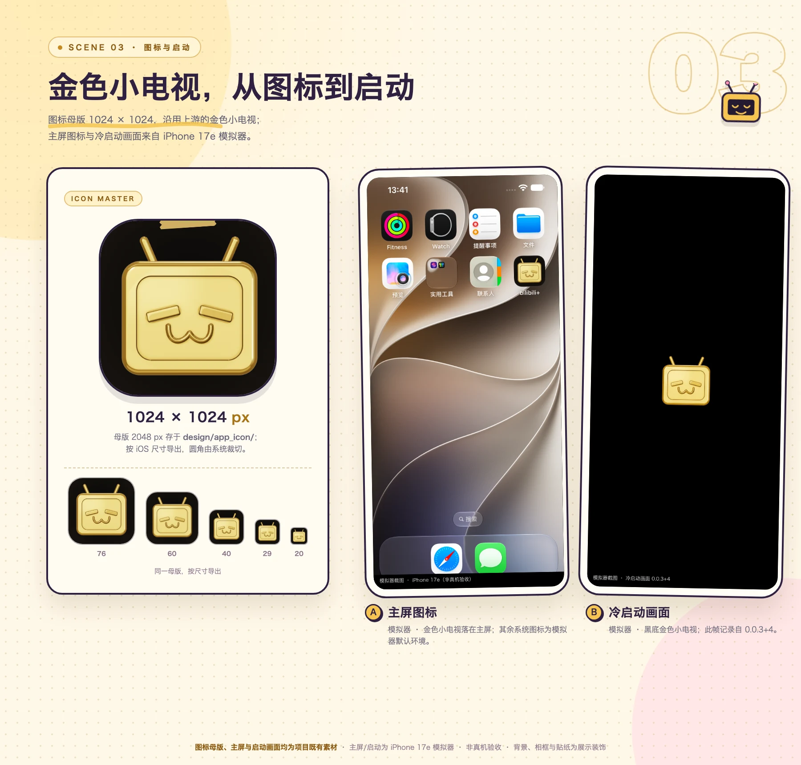
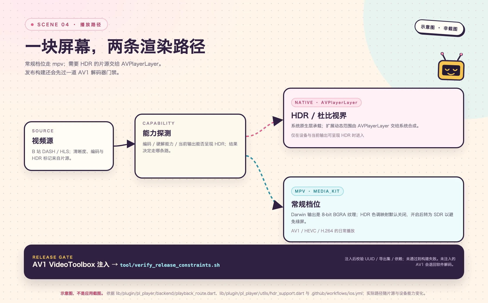
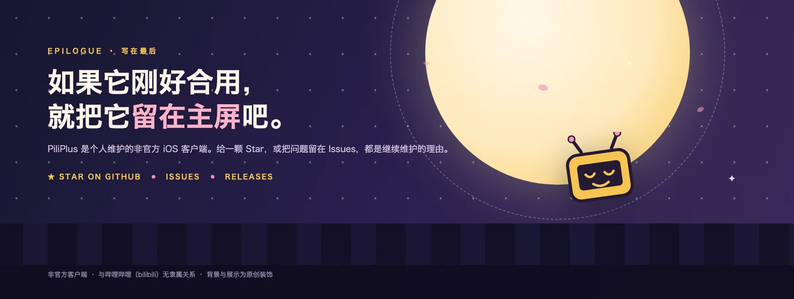

  

原创插画，不是应用截图；真实界面见 <a href="#界面预览">界面预览</a>。

<h1 align="center">PiliPlus</h1>

<strong>把 bilibili 放进 iPhone 与 iPad 的第三方客户端。</strong>

  

  

  

  

  <a href="#下载与安装">下载与安装</a> ·
  <a href="#快速开始">快速开始</a> ·
  <a href="#界面预览">界面预览</a> ·
  <a href="#开发与构建">开发与构建</a> ·
  <a href="https://github.com/devzer0o0/BilibiliPlus/releases">Releases</a>

> [!IMPORTANT]
> **非官方客户端。** 本仓库与哔哩哔哩（bilibili）及其关联公司没有隶属、合作或背书关系；不提供账号、视频源或官方服务。它只维护 iOS 构建目标，其他平台请使用[上游 PiliPlus](https://github.com/bggRGjQaUbCoE/PiliPlus)。IPA 需要自签名/侧载，不通过 App Store 分发。

## 这是什么

PiliPlus 是一个基于 Flutter 的 bilibili 第三方客户端。上游 [PiliPlus](https://github.com/bggRGjQaUbCoE/PiliPlus) 提供多平台实现；本仓库是从上游 fork 出来的 iOS 分支，面向 iPhone 和 iPad，保留上游的社区功能，把主要精力放在 iOS 播放链路、液态玻璃底栏和金色图标 / 启动画面。

它适合：

- 想在 iPhone / iPad 上使用 bilibili 第三方客户端，并愿意自行签名的用户；
- 想研究 Flutter 与 iOS 原生播放器、原生玻璃和图标生成管线的开发者；
- 已经使用上游 PiliPlus，想跟进这个 iOS 分支改动的贡献者。

这一支的目标很具体：播放器按片源和设备能力分流，底栏在 iOS 26+ 使用系统原生玻璃，图标与启动画面有可复现的母版和脚本，AI 推荐与 S3 备份则是默认关闭的可选项。它不追求“全平台”，也不提供 bilibili 账号、视频源、破解或任何官方服务。

## 核心能力

| 能力 | 能做什么 | 状态 |
| --- | --- | --- |
| 双播放后端 | 常规档位走 MediaKit / libmpv；设备与当前输出能呈现 HDR 时，HDR / 杜比视界片源走 AVPlayerLayer。同一会话只使用一条路径。 | 默认开启；HDR 路径有限验证 |
| 4K 档位与 AV1 / HEVC | 4K 是片源与账号清晰度档位，不是所有视频都有。仓库记录中，iPhone Air + iOS 27.3 的 AV1 8-bit SDR 4K60 硬解通过；AV1 / HEVC 片源由播放后端处理。 | AV1 有限验证；HEVC 未单独做硬解验收 |
| 液态玻璃底栏 | iOS 26+ 使用系统 UIGlassEffect；iOS 15–25 回退到 Flutter 玻璃。三个入口、可移动的选中胶囊；移动端默认开启。 | iOS 26+ 原生；旧系统回退 |
| 金色图标与启动画面 | <code>design/app_icon/master-2048.png</code> 是图标母版；<code>tool/app_icon/</code> 负责渲染与资产生成，启动画面同步生成。 | 设计管线；非运行时功能 |
| AI 推荐筛选 | 默认关闭。本地硬过滤先跑，AI 只对幸存结果重排 / 折叠，不能复活被过滤内容；提供偏好排序、严格精选两种模式。 | 可选；需 OpenAI 兼容模型 |
| S3 兼容加密备份 | 将备份加密后写入 S3 兼容存储；凭据保存在系统安全存储；S3 Secret 不作为备份密钥。 | 可选；需 S3；完整恢复未验收 |
| 继承的社区功能 | 首页 / 动态 / 搜索 / 视频详情 / 弹幕 / 收藏 / 历史 / 稍后再看 / 离线缓存 / 直播 / 私信 / 多账号 / WebDAV / SponsorBlock 等来自上游。 | 沿用上游；未逐项回归 |

“默认开启”指应用默认行为；“有限验证”只对应仓库记录中的设备和片源，不构成对所有设备的保证。具体未测项见[已知边界](#已知边界)。

## 界面预览

以下展示板使用仓库现有验收素材，把真实 / 模拟器截图放进原创相框与背景；**应用 UI 没有被重绘**。每张图都可以点开查看原尺寸。

  
   
  <b>A · 首页</b>　顶部搜索、双列推荐流、底部三个入口。 
  <b>B · 我的</b>　收藏、历史、缓存、订阅与账号概览。 
  真实应用截图（iPhone 真机，浅色模式）；头像与昵称已模糊；相框、贴纸与背景为展示装饰。

  
   
  <b>A · 浅色动态</b>　玻璃胶囊叠在信息流上；选中「我的」。 
  <b>B · 深色动态</b>　同一结构换成暗色材质。 
  模拟器截图（iPhone Air · iOS 27.2 · DEBUG 构建），已裁去状态栏、调试浮层与页面头部；账号头像已模糊；深色真机尚未验证。

  
   
  <b>左 · 图标母版</b>　1024 px 展示稿（母版 2048 px）与 76 / 60 / 40 / 29 / 20 尺寸阶梯；母版源文件为 <code>design/app_icon/master-2048.png</code>。 
  <b>右 · 主屏与启动</b>　iPhone 17e 模拟器；启动画面记录自 0.0.3+4。 
  图标母版、主屏与启动画面均为项目既有素材；主屏与启动为模拟器截图（非真机）；相框、贴纸与背景为展示装饰。

  
   
  <b>一块屏幕，两条渲染路径。</b>　示意图，不是应用截图；依据 <code>lib/plugin/pl_player/backend/playback_route.dart</code>、<code>lib/plugin/pl_player/utils/hdr_support.dart</code> 与 <code>.github/workflows/ios.yml</code> 整理。

> 图片的设备、版本、脱敏与授权说明见 [SOURCES.md](docs/images/readme/SOURCES.md)。仓库里暂未提供可复用的搜索、播放器与设置页截图，本页不拿旧图补位。

## 下载与安装

### 普通用户：下载现成 IPA

**先选对 Release。** 截至 2026-11-07：

- 本仓库最新 Release <code>v0.0.4</code> 没有附带 IPA；
- 本仓库 <code>v0.0.2</code> / <code>v0.0.1</code> 的 IPA 是更早构建，不代表当前源码；
- 上游 [PiliPlus Releases](https://github.com/bggRGjQaUbCoE/PiliPlus/releases) 的最新 iOS 包（当前为 <code>2.2.0.2</code>，资产名形如 <code>PiliPlus_ios_2.2.0+5598.ipa</code>）是可直接下载的现成包；安装时仍需自签名 / 侧载。它是上游版本，不包含本分支的全部改动。

如果你要的是本分支当前代码，请从源码构建；本仓库目前没有为当前源码提供签名 IPA，上面的 <code>v0.0.1</code> / <code>v0.0.2</code> 是旧构建。

**安装步骤：**

1. 在 iPhone / iPad 上准备你自己的签名或侧载工具（例如 AltStore、Sideloadly 等），以及可用的签名证书。本项目不提供证书，不代签，也不收集 Apple ID。
2. 下载 <code>.ipa</code>，确认来源是上游 Release；不要使用来路不明的第三方 IPA。
3. 用你信任的工具签名安装。若系统提示未受信任的开发者，按系统提示到「设置 → 通用 → VPN 与设备管理」信任对应证书；不同工具和系统版本的文案可能不同。
4. 打开应用。登录在应用内完成，账号功能需要登录；README 不会索取或保存你的账号凭据。

**系统要求：**

| 项目 | 要求 |
| --- | --- |
| 系统 | iOS / iPadOS 15.0 或更高 |
| 设备 | iPhone / iPad；当前验收以 iPhone 为主，iPad 布局尚未逐项验证 |
| 分发方式 | 自签名 / 侧载；不通过 App Store，也不提供 TestFlight |
| 网络与账号 | 使用时需要网络；收藏、历史、动态、私信等账号功能需要登录 |

### 开发者：从源码运行

从源码运行需要 macOS + Xcode，步骤、环境版本和命令见[开发与构建](#开发与构建)。普通安装不需要安装 Flutter 或 Xcode。

## 快速开始

安装并打开后，可以按这个顺序体验：

1. **看首页。** 底部三个入口是「首页 / 动态 / 我的」；首页顶部可以搜索，推荐流可手动刷新。
2. **打开一个视频。** 播放器会按片源、编码与当前设备能力选择后端；常规档位走 MediaKit / libmpv，HDR 路径在条件满足时走 AVPlayerLayer。
3. **登录（可选但推荐）。** 在「我的」按页面提示登录；登录后收藏、历史、动态、私信等账号功能才会跟账号走。
4. **看液态玻璃底栏。** 「我的」→ 右上角「设置」→「外观设置」→「液态玻璃底栏」。iOS 26+ 使用系统原生玻璃；iOS 15–25 自动回退到 Flutter 实现。移动端默认开启，可在这里关闭；切换后需重启应用。
5. **试 AI 推荐筛选。** 「设置」→「推荐流设置」→「AI 推荐筛选」，默认关闭。开启后选「偏好排序」或「严格精选」，按页面提示填写 OpenAI 兼容的 Base URL、模型与 API Key。没有模型时保持关闭，推荐流仍按本地规则工作。
6. **试 S3 备份。** 「设置」→「S3 兼容备份」，填写 Endpoint、Bucket、Region、Prefix、Access Key、Secret（以及可选的 Session Token）；先「保存并测试连接」，再「立即备份」。
7. **调 HDR。** 「设置」→「音视频设置」→「HDR 色调映射」，默认关闭。开启后可选 HDR / 杜比视界画质，但受 8-bit 渲染通路限制会映射为 SDR；设置页提示不做此映射会绿屏。遇到 HDR 片源发绿时再开启，普通片源建议保持默认。

> 这些路径来自当前设置页。不同构建的入口名称可能有细微差异；关键字段和开关以应用内为准。

## 开发与构建

### 环境

| 项目 | 要求 | 依据 |
| --- | --- | --- |
| macOS | 能运行 Xcode 的 macOS | 构建 iOS 应用的前置条件 |
| Xcode | 27.2（仓库文档记录） | 仓库文档；未验证其他版本 |
| Flutter | 3.47.9 | <code>.fvmrc</code>、<code>pubspec.yaml</code>、CI |
| Dart | ≥ 3.13.0 | <code>pubspec.yaml</code> |
| 部署目标 | iOS / iPadOS 15.0+ | <code>ios/Podfile</code>、Xcode 工程 |
| 设备目标 | iPhone + iPad（<code>TARGETED_DEVICE_FAMILY=1,2</code>） | Xcode 工程；当前验收以 iPhone 为主 |
| 真机签名 | 你自己的 Apple Development Team | 真机安装需要；README 不提供证书 |

本分支只维护 iOS 构建目标；Android、Linux、macOS、Windows 目录仍可能有上游脚手架，但不作支持承诺。需要其他平台请使用上游。

### 从源码运行

~~~bash
git clone https://github.com/devzer0o0/BilibiliPlus.git
cd BilibiliPlus
flutter pub get
flutter test --reporter compact
open ios/Runner.xcworkspace
~~~

在 Xcode 中选择 <code>Runner</code> target，打开 <b>Signing &amp; Capabilities</b>，选择你的 Team，然后选择设备运行。真机需要可用签名；模拟器不需要签名，但不能代表真机播放能力。

### 无签名编译

~~~bash
flutter build ios --release --no-codesign
~~~

这条命令只确认编译是否通过，不产出可安装的签名包。构建产物位于 <code>build/ios/iphoneos/Runner.app</code>。

### AV1 注入与产物校验

如果要在本地编译产物上补上 CI 同款的 AV1 解码器，并做产物校验，在签名前执行：

~~~bash
tool/ios_av1_package.sh install build/ios/iphoneos/Runner.app
tool/verify_release_constraints.sh build/ios/iphoneos/Runner.app
~~~

<code>tool/ios_av1_package.sh</code> 需要仓库内的 <code>ios/av1/Avcodec</code>，只接受 device arm64，拒绝模拟器；<code>tool/verify_release_constraints.sh</code> 会检查 bundle id、AV1 导出与 debug 残留，失败时以非零状态退出。

### CI

<code>.github/workflows/ios.yml</code> 是当前唯一的 iOS 工作流，包含测试、无签名构建、AV1 注入、产物校验与 IPA 打包；只有手动输入非空 tag 时才执行发布步骤。本次文档修订只读核对了 workflow 与脚本，没有运行该工作流，也没有把它标记为已通过。

CI 在编译前还会运行 <code>lib/scripts/build.ps1</code>（改写 <code>pubspec.yaml</code> 的 build 号、生成 <code>pili_release.json</code>）与 <code>lib/scripts/patch.ps1 iOS</code>（给仓库和 Flutter SDK 打 iOS 补丁）；构建时使用 <code>--dart-define-from-file=pili_release.json</code>。这两步依赖 CI 的 <code>GITHUB_ENV</code> / <code>FLUTTER_ROOT</code> 环境，不应直接当作本地命令。因此上面的最小本地构建与 CI 产物在版本号和 Flutter 补丁层面可能不同。

> 以上命令来自仓库配置、脚本和 CI。本次文档任务没有安装依赖、构建、签名或部署；首次执行时请以本机报错为准。

## 已知边界

| 边界 | 现状 |
| --- | --- |
| 4K / HDR | 4K 取决于片源、账号和清晰度档位。AV1 8-bit SDR 4K60 只在仓库记录的 iPhone Air + iOS 27.3 上验收；10-bit、HDR10、HLG、8K、杜比视界回归与 HDR 屏幕合成未逐项测量。HDR 色调映射默认关闭。 |
| 液态玻璃 | iOS 26+ 原生；iOS 15–25 自动回退 Flutter 实现。深色真机、VoiceOver、减少透明度与性能尚未完整验收。 |
| AI 推荐 | 默认关闭；需要 OpenAI 兼容的模型服务；不内置模型；真实模型服务未验收。模型不可达时回到本地规则；硬过滤不能被 AI 复活。 |
| S3 备份 | 使用 AES-256-GCM 加密；凭据保存在系统安全存储；S3 Secret 不作为备份密钥。完整真机恢复未验收，建议先用测试桶。 |
| 平台与继承功能 | 目标含 iPhone / iPad；当前验收以 iPhone 为主，iPad 布局未逐项验证。社区功能沿用上游，未做全量回归；不通过 App Store 分发。 |

## FAQ

### 它和 bilibili 官方是什么关系？

没有关系。它是非官方第三方客户端，与 bilibili 及其关联公司没有隶属、合作或背书；也不代表上游 PiliPlus 的官方立场。

### 它和上游 PiliPlus 是什么关系？

本仓库是 PiliPlus 的 fork，专注 iOS；上游继续维护多平台版本。通用功能问题可以对照上游；本分支改动的问题请提到本仓库 Issues。

### 为什么本仓库 Release 没有最新 IPA？

截至 2026-11-07，本仓库 <code>v0.0.4</code> 没有上传资产；<code>v0.0.1</code> / <code>v0.0.2</code> 的 IPA 较旧，不代表当前源码。需要现成 iOS 包请用上游最新 Release；需要本分支代码请自行构建。

### 支持 iPad 吗？

部署目标包含 iPhone 和 iPad（<code>TARGETED_DEVICE_FAMILY=1,2</code>），但当前验收以 iPhone 为主；iPad 布局尚未逐项验证。

### 安装时提示未签名或无法验证怎么办？

IPA 需要你自己的签名 / 侧载工具和证书。本项目不提供证书、不代签、不收集 Apple ID；按你使用的工具和系统提示处理。不要用来路不明的第三方 IPA。

### 4K / HDR 为什么跟设备有关？

4K 是清晰度档位；HDR 路径由设备与当前输出能否呈现 HDR 决定。仓库只在 iPhone Air + iOS 27.3 记录了 AV1 8-bit SDR 4K60；其他组合未逐项测量。HDR 色调映射默认关闭，开启后会映射到 SDR。

### AI 推荐筛选需要什么？

默认关闭；需要 OpenAI 兼容的 Base URL、模型和 API Key（API Key 存在系统安全存储）。本地硬过滤先跑，AI 只重排 / 折叠；没有模型时保持本地规则。真实模型服务尚未验收。

### S3 备份安全吗？

备份使用 AES-256-GCM 加密；凭据保存在系统安全存储，S3 Secret 不作为备份密钥。完整真机恢复尚未验收，建议先用测试桶验证。

## 项目结构

| 路径 | 内容 |
| --- | --- |
| <code>lib/</code> | Flutter 页面、播放器门面、AI 推荐、S3 备份等业务代码 |
| <code>ios/</code> | Runner、原生玻璃桥、AVPlayerLayer、AV1 资源与 Podfile |
| <code>test/</code> | 单元 / 组件测试；CI 运行 <code>flutter test</code> |
| <code>tool/</code> | 构建、AV1 注入 / 校验、回归与图标资产脚本 |
| <code>design/app_icon/</code> | 图标母版与设计源文件 |
| <code>docs/</code> | 架构、验证记录与素材来源；README 图片在 <code>docs/images/readme/</code> |
| <code>.github/workflows/ios.yml</code> | 当前唯一的 iOS CI 工作流 |

## 文档

| 文档 | 内容 |
| --- | --- |
| [播放架构](docs/ios-native-playback-architecture.md) | 双后端、选流与原生播放边界 |
| [AV1 验证记录](docs/ios-av1-hardware-evidence-2026-11-05.md) | 设备、构建与硬解证据 |
| [液态玻璃底栏](docs/liquid-glass-bottom-bar.md) | 原生玻璃、回退与验收记录 |
| [图标与启动画面](docs/app-icon-and-launch-screen.md) | 母版、脚本与模拟器截图说明 |
| [AI 推荐与 S3 备份](docs/ai-recommend-and-s3-backup.md) | 设计、字段与边界 |
| [首页共享视频流](docs/home-shared-videos.md) | 首页共享内容的改造记录 |
| [图片素材来源](docs/images/readme/SOURCES.md) | 设备、处理、授权与署名 |

## 参与贡献

仓库目前没有单独的 <code>CONTRIBUTING.md</code>；Issue 模板在 [<code>.github/ISSUE_TEMPLATE/</code>](.github/ISSUE_TEMPLATE/)。

- 可复现的问题请走 [Issues](https://github.com/devzer0o0/BilibiliPlus/issues)；涉及上游通用功能时，也可以先对照[上游 Issues](https://github.com/bggRGjQaUbCoE/PiliPlus/issues)。
- 代码改动请走 [Pull Requests](https://github.com/devzer0o0/BilibiliPlus/pulls)。较大的改动建议先开 Issue 讨论，避免和上游或当前分支的方向冲突。
- 播放 / 界面改动请附设备型号、iOS 版本、构建来源和截图；只在本机模拟器验证时请注明。
- 不要提交证书、描述文件、API Key、S3 凭据、恢复码、Cookie 或任何个人信息。贡献代码按仓库的 GPL-3.0 许可。

## 致谢

感谢这些让本项目得以存在的项目：

- [PiliPlus](https://github.com/bggRGjQaUbCoE/PiliPlus)：本仓库的上游；
- [PiliPalaX](https://github.com/orz12/PiliPalaX) 与 [pilipala](https://github.com/guozhigq/pilipala)：上游谱系中的相关项目；
- [bilibili-API-collect](https://github.com/SocialSisterYi/bilibili-API-collect)：接口资料；
- [media-kit](https://github.com/media-kit/media-kit)、[FFmpeg](https://www.ffmpeg.org/) 与 [mpv](https://mpv.io/)：播放与媒体处理；
- [dio](https://pub.dev/packages/dio)：网络请求。

这些项目仅作为上游、依赖或参考资料，不构成本项目获得其官方背书的声明。

## 许可证

代码以 [GNU General Public License v3.0](LICENSE) 发布。你可以按 GPL-3.0 使用、修改和分发；分发修改版时请遵守同一许可证。

README 中新增的原创插画、示意图和展示版式同样按 GPL-3.0 提供；真实应用截图及截图中的 bilibili 界面、头像、视频封面、商标和内容，不因本仓库的代码许可证而被重新许可。逐项来源、设备、处理与署名见 [docs/images/readme/SOURCES.md](docs/images/readme/SOURCES.md)。

PiliPlus 是非官方客户端，与哔哩哔哩（bilibili）及其关联公司没有隶属、合作或背书关系。它不提供账号、视频源或任何官方服务；使用需遵守 bilibili 用户协议和当地法律。

  
   
  原创收尾插画；背景与展示为装饰，不是应用截图。
    
  <strong>如果这个分支刚好合用，欢迎 Star、提 Issue，或把你的改动做成 PR。</strong>
    
  <a href="https://github.com/devzer0o0/BilibiliPlus">Star</a> ·
  <a href="https://github.com/devzer0o0/BilibiliPlus/issues">Issues</a> ·
  <a href="https://github.com/devzer0o0/BilibiliPlus/releases">Releases</a>

