<div align="center">
  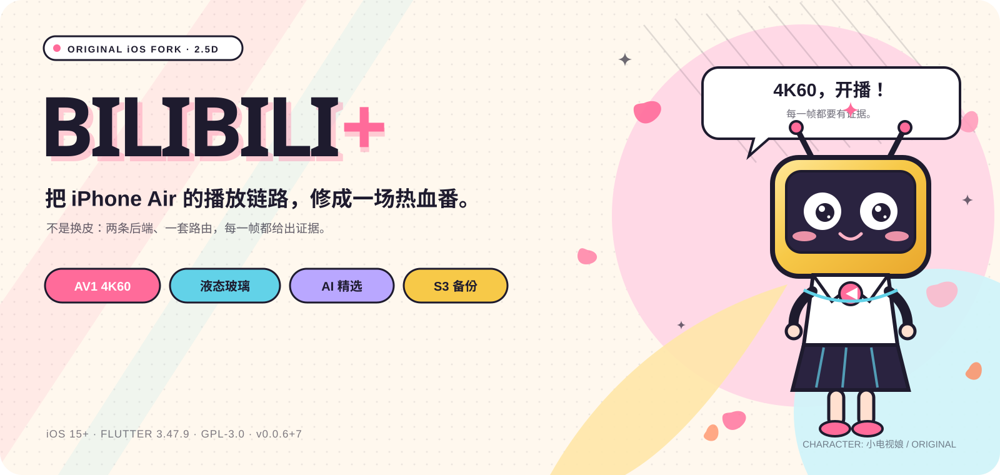
  <br>
  <sub>主视觉：小电视娘在樱花与速度线里按下播放键。原创角色，非官方素材。</sub>
  <br><br>
  
  
  
  
  <p><b>只做 iOS 的 B 站第三方客户端：把播放、界面和数据链路拆开、修好，并留下证据。</b></p>
  <p>
    <a href="https://github.com/devzer0o0/BilibiliPlus/releases"><b>下载 IPA</b></a> ·
    <a href="#quick-start">快速开始</a> ·
    <a href="#features">功能</a> ·
    <a href="#docs">设计文档</a> ·
    <a href="README.en.md">English</a>
  </p>
  <sub>徽章说明：iOS 15+；Flutter 3.47.9；GPL-3.0；当前版本 0.0.6+7。</sub>
</div>

> [!IMPORTANT]
> **这是 iOS-only 分支。** Android / Windows / Linux / macOS 的 runner 已移除；需要这些平台请使用上游 [PiliPlus](https://github.com/bggRGjQaUbCoE/PiliPlus)。下文所有“真机已验证”都限定在 iPhone Air（iPhone18,4）与写明的系统 / 构建版本上；模拟器、产物和自动化证据会单独标注。

> [!NOTE]
> 这份 README 只展开本仓库**实际改过、拿得出证据**的部分。继承自上游的功能只列名称，不冒充逐项回归；没有验证的项目会明确标注。文中所有插画、图标与截图均未使用上游原 README 的图片。

## 目录

- [为什么是这个分支](#why-this-fork)
- [截图](#screenshots)
- [功能](#features)
- [快速开始](#quick-start)
- [仓库结构](#repository-layout)
- [构建与验证](#build-and-verify)
- [兼容性与边界](#compatibility)
- [路线图](#roadmap)
- [参与贡献](#contributing)
- [文档索引](#docs)
- [许可与致谢](#license)

<a id="why-this-fork"></a>
## 为什么是这个分支 · Why this fork

上游 PiliPlus 已经是一个功能完整的 B 站客户端。这个分支没有做“全平台重写”，而是把 iOS 这条线当成一集来做：先修播放，再修界面，最后把推荐与备份补成可回滚的支线。

> 不是换皮：两条后端、一套路由，每一帧都给出证据。

| 篇章 | 本分支改了什么 | 验证到哪 |
| --- | --- | --- |
| 播放 | mpv + AVPlayerLayer 双后端；构建时注入并校验 AV1 VideoToolbox；输出按屏幕像素计算 | ✅ 真机 4K60 |
| 界面 | iOS 26 液态玻璃底栏；金色小电视图标与启动画面 | ✅ 真机材质 / 产物 |
| 推荐 | 可选 AI 语义筛选 / 排序；硬过滤前置；7 天冷启动快照 | 🟡 单测 / 构建 |
| 备份 | S3 兼容 + AES-256-GCM + 恢复码 | 🟡 逻辑 + MinIO |
| 分享区 | 纯文本分享、过滤顺序、标题三个修复 | ✅ 日志 / 单测 |
| 平台 | 只保留 iOS 工程；CI 补上测试 | ✅ 目录 / CI |

图例：✅ 有真机或产物证据；🟡 自动化 / 模拟器 / 局部服务验证；▶️ 已实现但未真机运行；⛔ 未验证。后文按这个标准写。

**如果你只想看一处：** 播放看[播放篇](#playback)，界面看[界面篇](#interface)，数据链路看[数据篇](#data)；每节末尾都链接到完整设计文档。

<a id="screenshots"></a>
## 截图 · Screenshot book

<p align="center">
  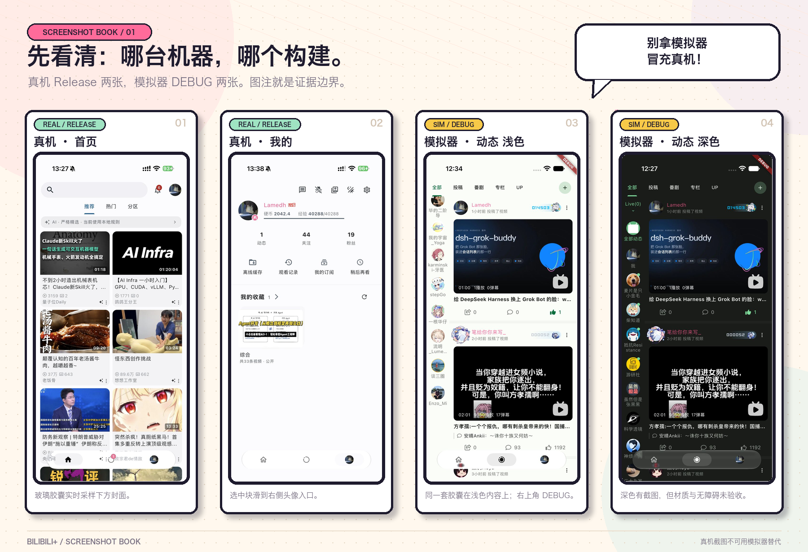
</p>

<p align="center"><sub><b>图 1</b> · 上排：真机 Release；下排：模拟器 DEBUG。真机证明材质与选中态，模拟器只证明布局和深色适配。</sub></p>

上排是 iPhone Air 真机 Release 截图，底栏的玻璃胶囊会实时采样下方内容；下排是 iPhone Air 模拟器（iOS 27.2）的浅色 / 深色动态页，右上角 DEBUG 角标用于区分构建来源。

深色有模拟器截图，但深色真机、材质与辅助功能的逐项验收仍未完成。把模拟器图当“真机验收”是这份 README 最不想制造的错误。

<a id="features"></a>
## 功能 · Features

下面四集只讲本分支动过的部分。上游已有的推荐、搜索、视频详情、弹幕、直播、私信等功能仍然随包提供，但不在正文里重复。

<p align="center">
  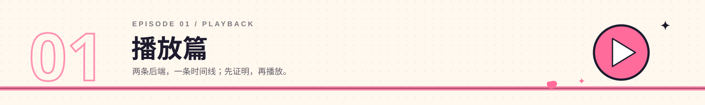
</p>

<a id="playback"></a>
### 播放篇 · 两条后端，一条时间线（本分支重做）

“芯片支持 AV1”不等于“这个 App 在用硬件解 AV1”。本分支要求四件事同时成立：

1. **芯片能解** — VideoToolbox 报告支持 AV1。
2. **构建里真的有解码器** — 打包进 App 的 FFmpeg 注册了 `av1_videotoolbox`；`tool/ios_av1_package.sh` 核对 Mach-O UUID、359 个导出符号（ABI 61.3.100）、依赖库和设备 / 模拟器 slice。任何一项不成立，构建失败。
3. **选流选对了** — 优先挑能硬解的 AV1 变体，同时尊重用户自己的编码偏好。
4. **会话确实在硬解** — 播放器每帧回报 `hwdec-current=videotoolbox`，帧格式是 `CVPixelBuffer`；libmpv 日志显示 `videotoolbox[nv12]`。

| 能力 | 路径 | 状态 |
| --- | --- | --- |
| AV1 8-bit SDR | mpv + FFmpeg + VideoToolbox | ✅ 真机实测硬解（4K60 / 4K30） |
| HEVC / H.264 | mpv + VideoToolbox | ✅ 真机实测硬解（含 4K60 回归） |
| HDR10 | AVPlayerLayer | ✅ 真机选中 Main10 / PQ 变体并出画；屏幕 HDR 合成未验证 |
| HLG | AVPlayerLayer | ▶️ 路由已接入；本轮没有 HLG 片源 |
| 杜比视界 | AVPlayerLayer + 系统还原 RPU | ▶️ 路由已接入；采样片源未出现 `dvh1`，未实测 |
| AV1 10-bit SDR | AVPlayerLayer | ✅ 真机画面正确、无绿屏；硬解状态记 `unavailable`，不伪造 |

<p align="center">
  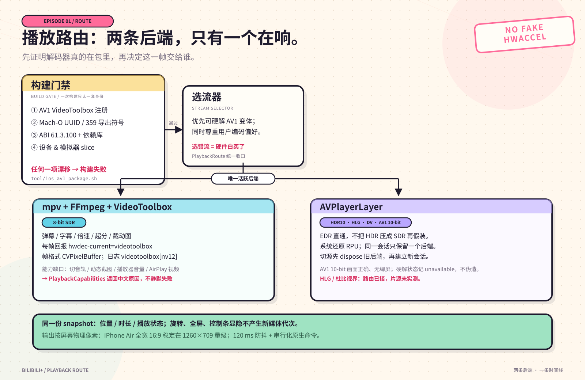
</p>

<p align="center"><sub><b>图 2</b> · 播放路由：先验证解码器真的在包里，再决定这一帧交给谁。图是结构图，不是调用时序图。</sub></p>

**实测记录（iPhone Air，iPhone18,4，iOS 27.3，签名 Release 之前的诊断构建）**

| 片源 | 规格 | 采样 | 硬解 |
| --- | --- | --- | --- |
| AV1 | 3840×2160 @60fps `av01.0.13M.08` | 31 | 31 |
| AV1 | 4096×2160 @59.994fps `av01.0.13M.08` | 32 | 32 |
| AV1 | 3840×2024 @59.932fps `av01.0.13M.08` | 32 | 32 |
| AV1 | 3840×2160 @29.97fps `av01.0.13M.08` | 2 | 2 |
| H.264 | 3840×2160 @60fps（回归） | 13 | 13 |

架构上的取舍：

- **8-bit SDR 走 mpv**：弹幕、字幕、倍速、超分、截动图这些功能都在。
- **HDR10 / HLG / 杜比视界 / AV1 10-bit 走 AVPlayerLayer**：真正的 EDR 直通，不把 HDR 压成 SDR 再假装。
- 同一会话只有一个后端；切源时旧后端先 dispose，不会两个后端同时开着、只隐藏一个。位置、时长、播放状态来自同一个 snapshot；旋转、全屏、控制条显隐不产生新媒体代次。
- 原生路径没有的能力（切音轨、动态截图、超分、播放器音量、AirPlay 视频）统一走 `PlaybackCapabilities` + `PlaybackRoute`，按 `preparing / native / disposed / none` 返回中文原因，不静默失败。
- **输出按屏幕，不按片源**：按显示区物理像素分配，iPhone Air 全宽 16:9 稳定在 **1260×709** 量级；DPR、BoxFit 裁切 / 拉伸、显式比例、旋转、窗口变化、手势缩放都参与计算，上限是片源尺寸。120 ms 防抖与串行化原生命令避免连续拖动时反复重建；Anime4K 开启或硬解关闭时保留完整片源输出。

完整架构与证据等级见 [docs/ios-native-playback-architecture.md](docs/ios-native-playback-architecture.md)；原始测试记录见 [docs/ios-av1-hardware-evidence-2026-11-05.md](docs/ios-av1-hardware-evidence-2026-11-05.md)。

<p align="center">
  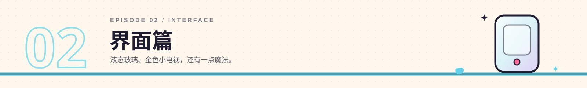
</p>

<a id="interface"></a>
### 界面篇 · 液态玻璃、金色小电视（本分支重做）

移动端底栏参考录屏里的液态玻璃胶囊：首页 / 动态 / 我的三个入口、无文字、图标居中、选中项背后一块浅色胶囊。页面切换、回顶刷新、动态角标、头像与安全区仍由原有控制器负责。

<p align="center">
  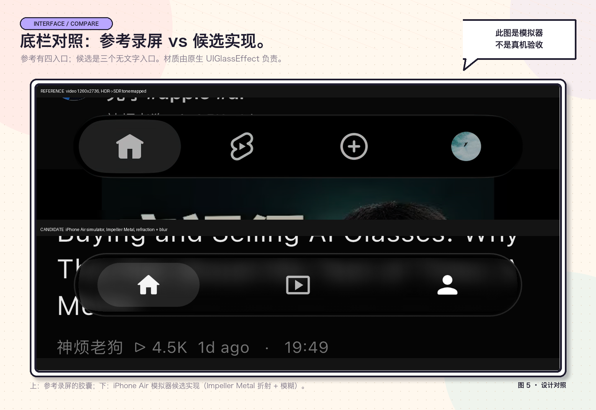
</p>

<p align="center"><sub><b>图 3</b> · 参考录屏（上）与 iPhone Air 模拟器候选实现（下）。候选实现使用 Impeller Metal 折射与模糊；这不是真机验收。</sub></p>

- **iOS 26 及以上**：`UIVisualEffectView` + `UIGlassEffect(style: .clear)`，`isInteractive = true`；胶囊高 52 pt、最大宽 360 pt、左右边距 30 pt、圆角 26；选中块 82×36，圆角 18。Flutter 只负责页面、业务状态、外层布局和无障碍标签；原生视图负责材质、三个按钮、选中块、角标和命中测试。
- **iOS 26 以下 / 非 iOS / 能力查询失败 / 平台视图 3 秒内未创建**：走 Flutter 回退（BackdropFilter + shader），日志打印 `[native-glass] Flutter fallback: <原因>`。支持原生的设备不允许静默回退后仍按原生验收。
- **无障碍与偏好**：VoiceOver 的按钮标签、选中态、未读数都有对应字段；降低透明度、提高对比度、减少动态效果各有处理路径。键盘弹出时底栏退出布局、命中与语义。
- **已验证**：真机材质日志 `material=UIGlassEffect.clear`、三入口点击、滚动时胶囊内亮度随内容变化（111→235→252→118）、进入视频详情页后胶囊消失、返回恢复。
- **未验证**：深色主题下的材质与辅助功能逐项验收、按压动效体感、VoiceOver、降低透明度 / 提高对比度、键盘、旋转、前后台恢复、内存与帧率。

上一版图标是“bilibili 国际版官方图标只换颜色”（金黄底 + 白色字标 + 左上角地球）。这次按 B 站百万粉丝纪念奖牌中央的**金色小电视**重绘：宽圆角矩形机身、双天线、内凹屏框、浮雕眼嘴；没有字标、地球、底脚、旋钮或文字。

<p align="center">
  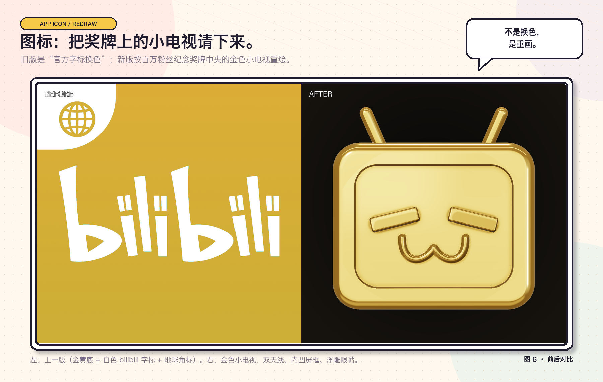
</p>

<p align="center"><sub><b>图 4</b> · 左边是上一版；右边是按奖牌中央小电视重绘的版本。金属反射、倒角和屏框阴影都由几何与光照生成。</sub></p>

<p align="center">
  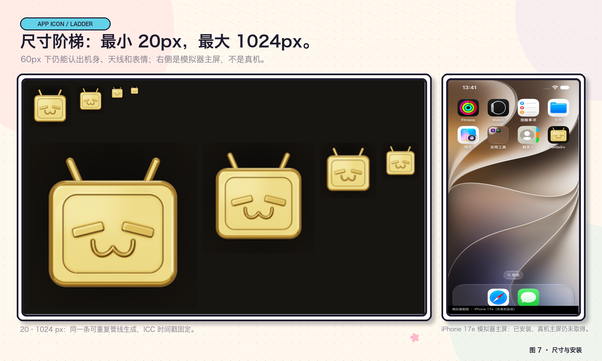
</p>

<p align="center"><sub><b>图 5</b> · 20–1024 px 的尺寸阶梯与 iPhone 17e 模拟器主屏。右侧是模拟器安装结果，真机主屏截图仍未取得。</sub></p>

- **设计母版**：`design/app_icon/master-2048.png`（2048²）是唯一定义源；1024 图标与透明小电视素材由它派生，母版不会被反向覆盖。
- **生成方式**：`tool/app_icon/render_icon.py` 用 SDF 光线步进（机身 / 天线 / 眼睛）+ 前表面高度场浮雕（屏面 / 嘴唇）+ 程序化棚拍环境 + GGX + ACES 渲染；没有用图像生成模型，所有形状参数都是可编辑常量。
- **可重复管线**：`tool/app_icon/build_assets.py` 每次从三张母版重新采样，生成 iOS AppIcon 全尺寸、启动图、logo、ICO 与 Android 前景；ICC 时间戳固定，同输入逐字节同输出（两次完整运行的 SHA-256 一致）。
- **验收**：25 条 AppIcon 引用 / 21 个唯一文件，20–1024 尺寸逐项匹配；1024 图标 RGB、无 alpha、内嵌 sRGB；60 px 下仍能辨认金色小电视与天线；`actool` 编译通过。
- **启动画面**：保持黑底 + 居中的透明金色小电视。iOS 会缓存 launch storyboard 的快照，只换图片可能继续显示旧图，所以启动图资源从 `LaunchImage` 改名为 **`LaunchImageGoldTV`**，build 号提到 **0.0.3+4**；覆盖安装后 `Library/SplashBoard` 下 4 个快照全部重建，旧快照消失。

<p align="center">
  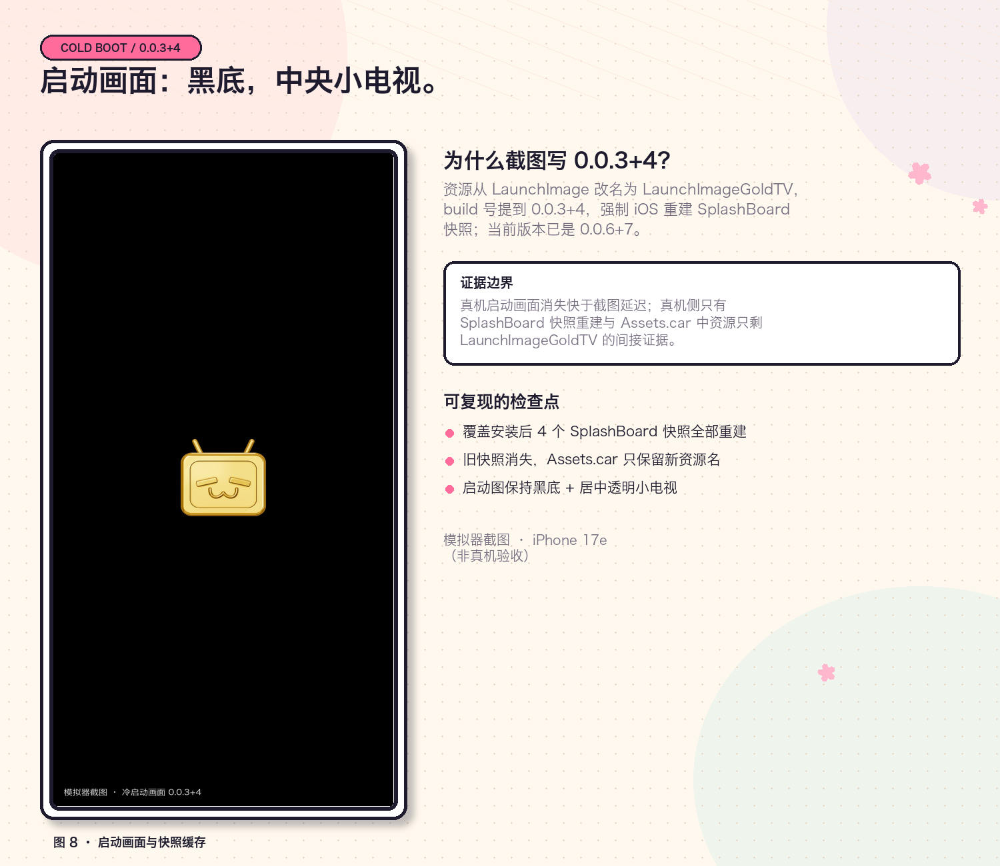
</p>

<p align="center"><sub><b>图 6</b> · 模拟器冷启动。截图仍标注 0.0.3+4，因为启动图缓存实验发生在该构建；当前版本为 0.0.6+7。真机启动画面消失快于截图延迟，真机侧的间接证据是 SplashBoard 快照重建与 Assets.car 中只剩 LaunchImageGoldTV。</sub></p>

完整设计来源、材质参数、资源清单与验收记录见 [docs/liquid-glass-bottom-bar.md](docs/liquid-glass-bottom-bar.md) 与 [docs/app-icon-and-launch-screen.md](docs/app-icon-and-launch-screen.md)。

<p align="center">
  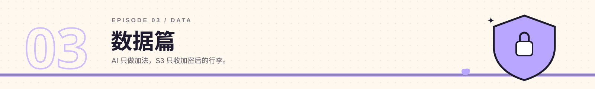
</p>

<a id="data"></a>
### 数据篇 · AI 只做加法，S3 只收加密后的行李（本分支新增）

AI 推荐与 S3 备份都是**可选支线**，默认关闭。它们共享一条原则：先由本地硬规则或显式白名单决定“什么能进来”，再做远程请求或上传；任何恢复都先预览，不直接覆盖现有设置。

<p align="center">
  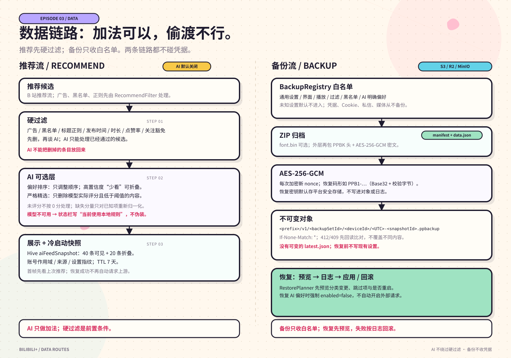
</p>

<p align="center"><sub><b>图 7</b> · 推荐与备份路径。AI 不能绕过硬过滤；备份默认只收白名单，恢复前不写现有设置。</sub></p>

#### AI 推荐筛选

AI 接在现有硬过滤之后：广告、黑名单、标题正则、发布时间、时长、点赞率、关注豁免仍由 `RecommendFilter` 先执行；AI 只给已经通过的候选打分、排序或折叠，**不能把删掉的条目放回来**。

- **两种模式**：`偏好排序` 只调整顺序，高置信度“少看”主题可折叠并在状态栏恢复；`严格精选` 只删除模型实际评分且低于阈值的内容，未评分内容保留。模型不可用时状态显示“当前使用本地规则”，不伪装成严格精选。
- **排序**：综合语义相关性、本地画像 / 关键词、明确想看 / 少看、新鲜度、B 站原顺序和作者偏好；缺失的评分不按 0 分处理，只对已知分量重新归一化。探索位约占 20%，同一作者连续出现时做一次相邻降权，软约束不突破硬过滤。
- **请求边界**：独立 Dio，不挂 B 站拦截器，不携带 Cookie / CSRF / access key / 设备头；默认只接受 HTTPS，loopback 或显式允许的私有网络地址可用 HTTP，公网 HTTP 始终拒绝；禁止重定向，避免 Authorization 被转发。API Key 只进平台安全存储。
- **预算与降级**：每批最多 20 个候选，每次刷新最多 2 批，每日默认 100 次；首屏等待预算 2 s，超时先用本地规则；后台预取下一页并使用更长的超时。刷新本身不发起模型请求，优先读取已准备好的结果。
- **冷启动快照**：每次成功展示后，把最多 40 条可见 + 20 条折叠的卡片字段、AI 分数 / 原因 / 折叠标记写入 Hive `localCache` 的 `aiFeedSnapshot`；启动时同步恢复，首帧就能看到上次推荐，不再先显示骨架屏。快照带账号作用域、来源和设置指纹，TTL 7 天；不匹配自动忽略。恢复成功后启动阶段不再自动请求推荐，页面保持快照内容并显示“使用缓存”；只有下拉刷新或快照缺失 / 不可用时才请求上游，刷新失败或超时保留可见内容。
- **隐私**：首次启用不自动读历史；导入需显式点击（最近 30 天、最多 200 条、只看 archive），账号不一致拒绝导入；暂停学习、匿名 / 无痕、初学者模式都会阻止写入；只保存内容偏好，不推断身份、健康、政治立场等敏感属性。

#### S3 兼容加密备份

这是与原有本地 ZIP / WebDAV 并列的新链路，旧入口保持不变。默认关闭，配置在“设置 → S3 兼容备份”。

- **支持的服务**：AWS S3、Cloudflare R2、MinIO 等 S3 兼容端点；可选 path-style / virtual-hosted、Prefix、Region、超时、自动备份间隔与保留数量。
- **默认备份**：通用设置、界面与主题、播放与弹幕偏好、推荐过滤规则、本地黑名单、AI 明确偏好。**单独勾选且默认关闭**：AI 推测画像与反馈、搜索历史、本地历史评论、播放进度、自定义字体。
- **从不备份**：B 站账号 / Cookie / CSRF / access key / refresh token、AI API Key、S3 凭据、WebDAV 密码、恢复密钥、私信、缓存 / 日志 / 下载媒体。新增未知设置默认不进入备份，必须加入 `BackupRegistry` 的显式白名单。
- **对象与加密**：对象键为 `<prefix>/v1/<backupSetId>/<deviceId>/<UTC时间>-<snapshotId>.ppbackup`，不可变；上传用 `If-None-Match: *`，412/409 时先回读比对，不覆盖不同内容，没有可变的 `latest.json`。外层是 `PPBK` 头 + AES-256-GCM 密文，每次加密新 nonce；内层 ZIP 含 `manifest.json`、`data.json` 与可选 `font.bin`。
- **恢复码**：256 位随机恢复密钥默认存平台安全存储；恢复码形如 `PPB1-...`（Base32 + 校验字节），新设备填入同样的 S3 配置和恢复码即可解密对应 keyId 的快照。
- **恢复**：下载 / 解密 / 校验阶段不写现有设置；先由 `RestorePlanner` 预览分类变更、跳过项和是否需要重启，应用前写恢复日志，失败按日志回滚旧值。恢复 AI 偏好时强制 `enabled=false`，不会自动打开外部请求。
- **验证到哪**：加密往返、错钥、篡改、截断、路径穿越、归档版本、恢复规划与回滚等 44 项左右测试通过；MinIO 的 List / Put / Get / Delete 连接测试已验证；**完整备份上传到真实 S3、从真实 S3 恢复的端到端真机验收未做**，真机 Keychain 读写也未验证。

接入位置、排名权重、缓存键、加密格式与恢复语义见 [docs/ai-recommend-and-s3-backup.md](docs/ai-recommend-and-s3-backup.md)。

<p align="center">
  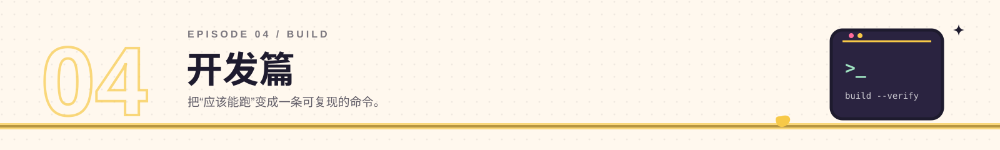
</p>

### 开发篇 · 分享修复与可复现构建（本分支修复）

首页推荐顶部会显示指定用户通过私信分享的视频。这条链路修了三个真实缺陷，也顺手把 iOS 工程与 CI 收成一条可复现的命令。

| 缺陷 | 修复 | 证据 |
| --- | --- | --- |
| **纯文本分享被整条丢弃** | 该用户发的是 `EN_MSG_TYPE_TEXT`，视频链接嵌在正文里，解析器只接受分享卡片。新增正文 `BV[0-9A-Za-z]{10}` 提取，且回退仅限纯文本类型，直播 / 动态卡片不会被“复活” | 12 条消息匹配 0 条 → 11 条 |
| **去重与过滤顺序颠倒** | 过滤曾放在“每个 bvid 保留最新副本”的去重之后，别人转发同一条视频就会把指定用户的副本顶掉。现在过滤提前，抽成 `foldForWanted()`，生产代码与测试共用同一实现 | 间歇性消失不再复现 |
| **标题显示成 URL** | 链接独占一行、标题在上一行，初版取了链接自己那一行。现在优先取同行的非 URL 文本，该行只有链接时向上取最近的非空行，并剥掉 `1.` / `1、` / `1《` 这类编号；加载后再用 `VideoHttp.videoIntro` 补全真实标题与封面，查询失败保留原值而不是丢弃条目 | 标题 / 封面补全测试通过 |

会话扫描窗口从 10 个扩到最多 40 个，并优先读取指定用户的会话，命中即停。测试覆盖纯文本解析、过滤顺序、标题与封面补全三个文件；详情见 [docs/home-shared-videos.md](docs/home-shared-videos.md)。

- **只保留 iOS**：移除 Android / Windows / Linux / macOS runner；仓库里只剩资源或 Flutter 插件注册骨架。需要那些平台请用上游。
- **CI 补上测试**：`.github/workflows/ios.yml` 先跑 `flutter test`，再构建、注入 AV1 解码器、校验产物并打包 IPA；以前只构建不跑测试。
- **构建门禁**：`tool/ios_av1_package.sh` 是所有构建入口共用的唯一实现；`tool/verify_release_constraints.sh` 检查 bundle id、AV1 ABI、导出符号和调试标记，任何一项漂移都会让构建失败。
- **无真机回归**：`tool/full_regression.sh` 把脚本自检、单元测试、Release 约束、实验脚手架扫描、HDR 选流门禁和 4K 精确性串在一起，失败即非零退出。

这一集没有新截图，它靠日志和测试说话。

<a id="quick-start"></a>
## 快速开始 · Quick start

- **直接安装**：从 [Releases](https://github.com/devzer0o0/BilibiliPlus/releases) 下载 IPA，用你自己的 Apple Development 证书签名 / sideload。仓库不附带证书、描述文件或任何凭据。
- **从源码构建**：需要 Flutter 3.47.9、Xcode 27.x 和一枚 Apple Development 证书；iOS 部署目标是 15.0。
- **只想先看改了什么**：从[为什么是这个分支](#why-this-fork)和[截图](#screenshots)开始；每节末尾都有对应的设计 / 证据文档。

```bash
git clone https://github.com/devzer0o0/BilibiliPlus.git
cd BilibiliPlus
flutter pub get

# 签名 Release：自动注入 AV1 VideoToolbox 解码器、校验身份、重签
PILIPLUS_DEVELOPMENT_TEAM=XXXXXXXXXX tool/ios_build.sh release
```

更完整的校验、回归与 CI 说明见[构建与验证](#build-and-verify)。

<a id="repository-layout"></a>
## 仓库结构 · Repository layout

| 路径 | 用途 |
| --- | --- |
| `lib/` | Flutter 页面、播放门面、推荐过滤与备份逻辑 |
| `ios/` | Runner、原生液态玻璃桥接、AVPlayerLayer、启动图与资源 |
| `tool/` | AV1 打包 / 校验、Release 约束、回归脚本、图标生成管线 |
| `test/` | 单元 / Widget 测试，包括分享区与备份恢复 |
| `docs/` | 设计、证据、验收记录与边界说明 |
| `design/app_icon/` | 图标母版与派生素材 |
| `.github/workflows/ios.yml` | iOS CI：测试、构建、注入解码器、校验产物、打包 IPA |

<a id="build-and-verify"></a>
## 构建与验证 · Build & verify

需要 **Flutter 3.47.9**、**Xcode 27.x**，以及一枚 Apple Development 证书。iOS 部署目标是 15.0。

```bash
# 只校验产物：解码器身份、导出符号集合、依赖库、诊断残留
tool/verify_release_constraints.sh build/ios/iphoneos/Runner.app

# 无真机也能跑的六段回归
tool/full_regression.sh
```

- `tool/ios_av1_package.sh` 是所有构建入口（本地脚本、CI）共用的唯一实现；`tool/verify_release_constraints.sh` 还会检查 bundle id、AV1 ABI、导出符号和调试标记，任何一项漂移都会让构建失败。
- `tool/full_regression.sh` 把脚本自检、单元测试、Release 约束、实验脚手架扫描、HDR 选流门禁和 4K 精确性串在一起，失败即非零退出。
- CI 在 `.github/workflows/ios.yml` 中执行 `flutter test`，然后构建、注入 AV1 解码器、校验产物并打包 IPA。仓库以前只构建不跑测试，这一步是本分支补上的。
- 构建产物、证书、描述文件、API Key、S3 凭据和恢复码都不进仓库。

<a id="compatibility"></a>
## 兼容性与边界 · Compatibility & status

- **只保留 iOS**：本分支移除了 Android / Windows / Linux / macOS 的 runner；仓库里只剩资源或 Flutter 插件注册骨架。需要那些平台请使用上游 PiliPlus。真机验证围绕 iPhone Air 做，模拟器与自动化证据单独标注；这是有意的取舍。
- **系统**：iOS 15.0+；原生液态玻璃需要 iOS 26+，低版本自动回退；HDR 原生路径从 iOS 15 起可用；AV1 硬解取决于芯片与片源。
- **主要目标设备**：iPhone Air（iPhone18,4），实测系统 iOS 27.3；Bundle ID 仍为 `com.example.pilipalax`，显示名 `bilibili+`。
- **版本**：`0.0.6+7`。

**这张表划出这份 README 的声明边界，不是装饰性的待办清单：**

| 项目 | 状态 | 原因 |
| --- | --- | --- |
| HDR 绿屏在 VideoToolbox 路径上是否被色调映射修复 | ⛔ | 模拟器无法复现；需要真机 HDR 片源逐帧比对 |
| HDR10 是否真正合成到屏幕；HLG / 杜比视界片源 | ⛔ | 真机只证明原生链路出画，未证明屏幕按 HDR 亮度呈现；后两者没有片源 |
| 深色液态玻璃、VoiceOver、降低透明度 / 提高对比度、帧率 | ⛔ | 深色有截图，但材质与辅助功能未逐项验收；xctrace 无法连接该设备 |
| 真机桌面图标与启动画面截图 | ⛔ | 启动画面消失快于截图延迟；只有快照重建与模拟器截图 |
| 原生 PiP、听视频、原生截图 | ▶️ | 代码与单测完成，真机 / 模拟器交互均未运行 |
| 真实 AI 模型服务 | ⛔ | 没有用户凭据；只有测试替身与本地服务 |
| 完整 S3 备份 / 恢复端到端 | ▶️ | MinIO 连接与对象往返已验证；完整链路未真机验收 |
| 真机 Keychain 读写 | ⛔ | 未验证 |
| macOS / Windows / Linux / Android | ⛔ | 本分支不构建这些平台 |

### 继承自上游（未逐项回归）

这个分支没有重写日常客户端，下面这些仍然随包提供：

- 推荐 / 热门 / 分区、搜索、视频详情、评论与评论笔记
- 弹幕 / 字幕 / 倍速 / 画质与音质选择 / 记忆播放 / 超分辨率
- 动态 / 直播 / 私信 / 收藏夹 / 历史 / 稍后再看 / 离线缓存
- 多账号、WebDAV、SponsorBlock、高级弹幕、视频截取动图 / Live Photo

它们沿用上游实现；本分支的改动集中在播放、底栏、图标、AI 推荐筛选、S3 备份和首页分享区。完整功能清单以上游 README 为准。

<a id="roadmap"></a>
## 路线图 · Roadmap

这是验证路线图，不是功能营销。已经完成的项有真机或自动化证据；未完成的项写清楚还缺什么。

- [x] AV1 4K60 硬解，构建时校验解码器身份
- [x] 原生液态玻璃底栏 + Flutter 回退
- [x] 可重复的金色小电视图标与启动画面
- [x] 可选 AI 筛选 + 7 天冷启动快照
- [x] S3 兼容加密备份 + 恢复码
- [ ] HDR10 屏幕合成与绿屏色调映射
- [ ] HLG / 杜比视界片源实测
- [ ] 原生 PiP / 听视频 / 原生截图真机交互
- [ ] 完整 S3 备份 / 恢复真机端到端
- [ ] 深色液态玻璃、VoiceOver、降低透明度、帧率
- [ ] 继承自上游的日常功能逐项回归

<a id="contributing"></a>
## 参与贡献 · Contributing

- Issue 和 PR 都欢迎，但这是个人分支：通用上游问题 / 功能请优先提到 [PiliPlus](https://github.com/bggRGjQaUbCoE/PiliPlus)。
- 改动尽量小，说明“改了什么、为什么、怎么验证”。涉及播放的 PR 请附设备型号、iOS 版本、构建身份和 `hwdec-current` 日志；涉及 UI 的 PR 请附前后截图；涉及备份的 PR 请跑相关测试。
- 不要提交证书、描述文件、API Key、S3 凭据、恢复码或任何个人数据。
- 提交即表示同意以 GPL-3.0 发布你的贡献。

<a id="docs"></a>
## 文档索引 · Docs

| 文档 | 内容 |
| --- | --- |
| [iOS 原生播放架构](docs/ios-native-playback-architecture.md) | 双后端、能力契约、输出尺寸与状态机 |
| [AV1 硬解真机证据](docs/ios-av1-hardware-evidence-2026-11-05.md) | 测试片源、构建身份、未测范围 |
| [液态玻璃底栏](docs/liquid-glass-bottom-bar.md) | 原生桥接、回退、无障碍与验收步骤 |
| [图标与启动画面](docs/app-icon-and-launch-screen.md) | 设计来源、材质参数、资源清单与验收 |
| [AI 推荐与 S3 备份](docs/ai-recommend-and-s3-backup.md) | 排名权重、缓存键、加密格式与恢复语义 |
| [首页分享视频](docs/home-shared-videos.md) | 纯文本解析、过滤顺序、标题补全 |

<a id="license"></a>
## 许可与致谢 · License

代码以 **GPL-3.0** 发布，见 [LICENSE](LICENSE)。Bilibili+ 与哔哩哔哩官方无关联；bilibili 名称与商标归其权利人所有。

> 本项目仅用于学习和测试，请于下载后 24 小时内删除；所用 API 均从官方网站收集，不提供任何破解内容。

- 上游与前辈：[PiliPlus](https://github.com/bggRGjQaUbCoE/PiliPlus)、[PiliPalaX](https://github.com/orz12/PiliPalaX)、[pilipala](https://github.com/guozhigq/pilipala)
- [bilibili-API-collect](https://github.com/SocialSisterYi/bilibili-API-collect)
- [media-kit](https://github.com/media-kit/media-kit)、[melodink-libmpv-darwin-build](https://github.com/gungun974/melodink-libmpv-darwin-build)
- [FFmpeg](https://ffmpeg.org/)、[mpv](https://mpv.io/)、[dio](https://pub.dev/packages/dio)
- 多账号支持：[My-Responsitories](https://github.com/My-Responsitories)

<p align="center">
  
</p>

<p align="center">
  <a href="https://github.com/devzer0o0/BilibiliPlus/releases">
    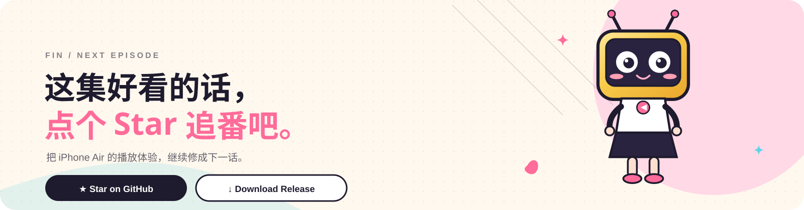
  </a>
</p>

<p align="center"><sub>这集好看的话，点个 Star 追番。下一话继续把 iPhone Air 的播放体验修好。</sub></p>
