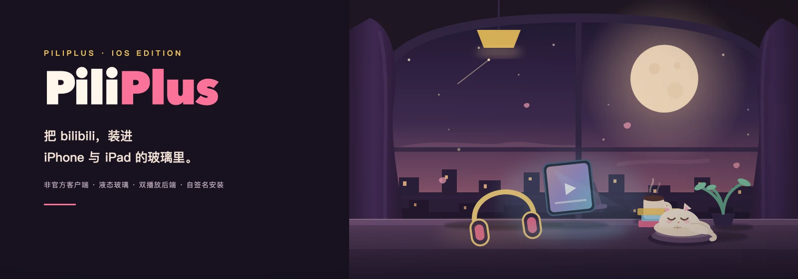
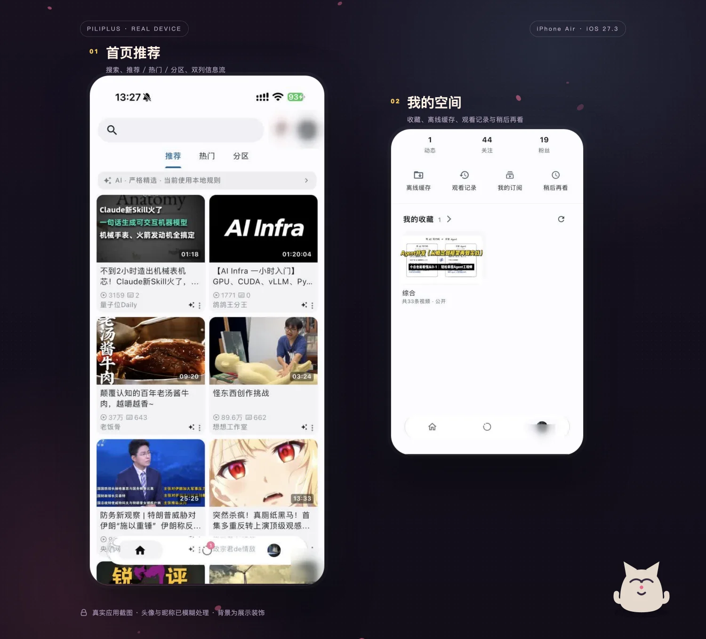
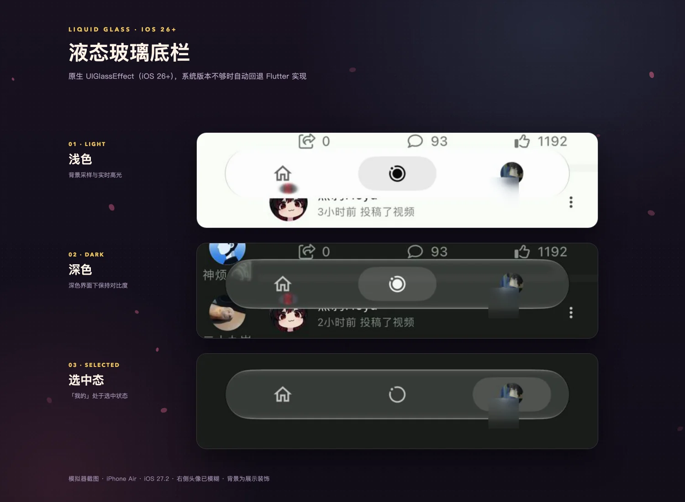
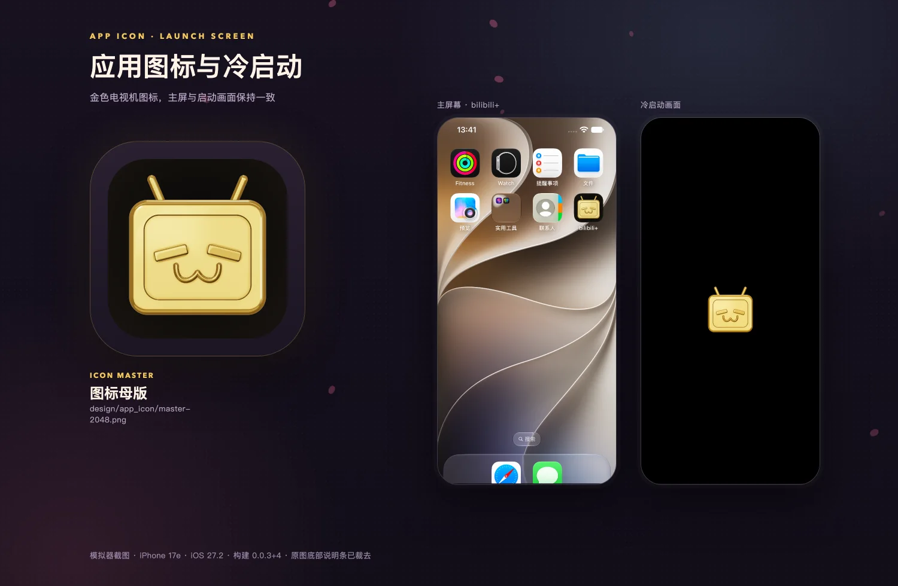
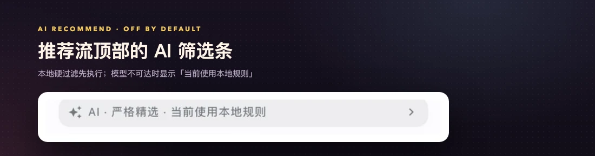
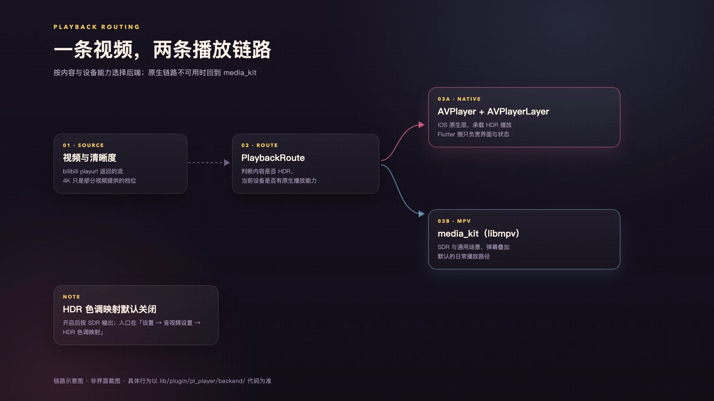
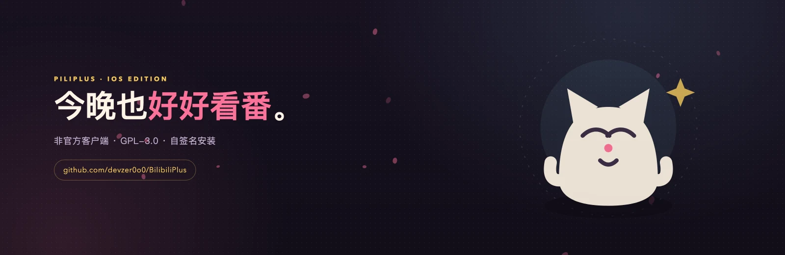

<div align="center">
  
</div>

<p align="center"><sub>原创插画 · 不是应用截图 · 真实界面见 <a href="#界面预览">界面预览</a></sub></p>

<h1 align="center">PiliPlus <sub>for iOS</sub></h1>

<p align="center">
  <b>把 bilibili，装进 iPhone 与 iPad 的玻璃里。</b><br>
  <sub>基于 Flutter 的第三方客户端 iOS 分支 · 液态玻璃底栏 · 双播放后端 · 自签名安装</sub>
</p>

<p align="center">
  <a href="https://github.com/devzer0o0/BilibiliPlus/releases"></a>
  <a href="https://github.com/devzer0o0/BilibiliPlus/actions/workflows/ios.yml"></a>
  
  
  
</p>

<p align="center">
  <a href="#界面预览">界面预览</a> ·
  <a href="#下载与安装">下载与安装</a> ·
  <a href="#快速开始">快速开始</a> ·
  <a href="#从源码构建">从源码构建</a> ·
  <a href="#常见问题">常见问题</a> ·
  <a href="https://github.com/devzer0o0/BilibiliPlus/releases">Releases</a>
</p>

> [!IMPORTANT]
> **非官方客户端。** 本仓库与哔哩哔哩（bilibili）及其关联公司没有隶属、合作或背书关系，也不代表上游 PiliPlus 的官方立场。本项目不提供账号、视频源或任何官方服务。
>
> **只维护 iOS。** 这是一个从 [上游 PiliPlus](https://github.com/bggRGjQaUbCoE/PiliPlus) fork 出来、只保留 iOS 构建目标的仓库；Android / Linux / macOS / Windows 请使用上游。IPA 需要你自己签名或侧载，**不通过 App Store 或 TestFlight 分发**。

## 这一支是什么

PiliPlus 本身是一个用 Flutter 写的 bilibili 第三方客户端。上游维护多平台版本；**本仓库只做 iOS**，把精力集中在三件事上：播放器要能按片源和设备能力走不同的渲染路径、底栏要贴合 iOS 26 起的系统玻璃材质、图标与启动画面要有可复现的生成管线。

除此之外，它还继承了上游完整的社区体验——首页、动态、搜索、视频详情、弹幕、收藏、历史、稍后再看、离线缓存、直播、私信、多账号、WebDAV、SponsorBlock 等，这些功能来自上游代码，本分支没有逐项回归。

**适合你，如果：**

- 你想在 iPhone / iPad 上用 bilibili 第三方客户端，并且愿意自己处理签名；
- 你在意 iOS 上的 HDR / 4K 播放链路，想看看 Flutter 与 AVPlayerLayer 怎么协作；
- 你想研究 Liquid Glass、原生 MethodChannel 桥接、图标生成管线这类 iOS 侧实现；
- 你已经在用上游 PiliPlus，想跟进这个 iOS 分支的差异。

**可能不适合你，如果：**

- 你要的是 App Store 一键安装——本仓库不提供；
- 你要 Android / 桌面端——请去上游；
- 你需要一个"打开就能用、不用折腾签名"的成品。

## 能力一览

| 能力 | 实际能做什么 | 状态 |
| --- | --- | --- |
| **双播放后端** | 每个片源只创建一条链路：10-bit 且设备能呈现 HDR 时用 `AVPlayer + AVPlayerLayer`，其余（含本地文件、SDR 档位、非 iOS）走 media_kit / libmpv。未选中的后端不会被创建，也不存在"暂停着等切换"。 | 默认行为；原生 HDR 路径为 iOS 限定 |
| **4K 与 AV1** | 4K 是清晰度**档位**，取决于片源与账号，不是所有视频都有。仓库记录中 iPhone Air + iOS 27.3 的 AV1 8-bit SDR 4K60 硬解通过。 | 有限验证，见[已知边界](#已知边界) |
| **液态玻璃底栏** | iOS 26+ 走 UIKit 原生 `UIVisualEffectView` + `UIGlassEffect`；系统版本不够、能力申请失败或 3 秒内未创建成功时，自动回退到 Flutter 实现。三个入口：首页 / 动态 / 我的。 | 移动端默认开启；可关 |
| **AI 推荐筛选** | 推荐流顶部多一条筛选条。本地硬过滤先跑，AI 只对幸存结果重排或折叠，**不能复活被过滤的内容**。分「偏好排序」「严格精选」两种口径。 | **默认关闭**；需 OpenAI 兼容服务 |
| **S3 兼容加密备份** | 备份内容以 AES-256-GCM 加密后写入你自备的 S3 兼容存储；凭据存系统安全存储，S3 Secret 不作为备份密钥。 | **默认关闭**；完整恢复未验收 |
| **图标与启动画面** | `design/app_icon/master-2048.png` 是母版，`tool/app_icon/` 负责渲染多尺寸资产与启动图；改母版即可重生成全套。 | 设计管线，非运行时功能 |
| **继承的社区功能** | 首页、动态、搜索、详情、弹幕、收藏、历史、稍后再看、离线缓存、直播、私信、多账号、WebDAV、SponsorBlock。 | 沿用上游；未逐项回归 |

<sub>"默认开启 / 关闭"描述的是应用出厂行为；"有限验证"只对应仓库里记录过的设备与片源，不构成对其他机型的保证。</sub>

## 界面预览

下面的展示板把仓库里已有的真实截图放进原创背景。**应用本身没有被重绘**：状态栏、底栏、卡片、按钮都来自截图原样。

<div align="center">
  <a href="docs/images/readme/scene-home-me.webp">
    
  </a>
  <br>
  <sub><b>左 · 首页</b>　顶部搜索、推荐 / 热门 / 分区切换、双列信息流、三个底部入口。<br>
  <b>右 · 我的</b>　动态 / 关注 / 粉丝计数，离线缓存、观看记录、我的订阅、稍后再看，以及收藏夹与订阅内容。<br>
  真实应用截图（iPhone Air · iOS 27.3 · 浅色）· 头像与昵称已模糊 · 背景为展示装饰</sub>
</div>

<br>

<details>
<summary><b>液态玻璃底栏：浅色、深色与选中态</b>（点击展开）</summary>

<br>

<div align="center">
  <a href="docs/images/readme/scene-liquid-glass.webp">
    
  </a>
  <br>
  <sub><b>01 浅色</b>　玻璃胶囊叠在信息流上，实时采样背景并带边缘高光。<br>
  <b>02 深色</b>　同一结构换成暗色材质，胶囊与背景仍有对比。<br>
  <b>03 选中态</b>　「我的」处于选中，胶囊跟随到右侧头像处。<br>
  模拟器截图（iPhone Air · iOS 27.2 · DEBUG 构建）· 右侧头像已模糊 · 深色真机尚未验收 · 背景为展示装饰</sub>
</div>

</details>

<details>
<summary><b>应用图标与冷启动画面</b>（点击展开）</summary>

<br>

<div align="center">
  <a href="docs/images/readme/scene-icon-launch.webp">
    
  </a>
  <br>
  <sub><b>左 · 图标母版</b>　`design/app_icon/master-2048.png` 的渲染结果：金色电视机、闭眼笑与天线。<br>
  <b>中 · 主屏</b>　iPhone 17e 模拟器主屏上的 bilibili+ 图标。<br>
  <b>右 · 冷启动</b>　黑底居中图标，记录自 `0.0.3+4`。<br>
  左为项目母版素材；中、右为模拟器截图（非真机）· 背景为展示装饰</sub>
</div>

</details>

<br>

<div align="center">
  <a href="docs/images/readme/detail-ai-filter.webp">
    
  </a>
  <br>
  <sub><b>AI 筛选条的三种状态之一</b>　条内写着「严格精选 · 当前使用本地规则」——这是模型未接入时的真实表现：筛选照常工作，只是判定来自本地规则。<br>
  真实应用截图（iPhone Air · iOS 27.3 · 浅色）局部裁切 · 背景为展示装饰</sub>
</div>

<br>

> 仓库里暂时没有可复用的**搜索页、视频详情页、播放器与设置页**截图，所以这里没有放。补齐这些场景需要新的真机或模拟器素材，本轮不拿旧图或概念图充数。逐张图片的设备、处理与授权记录见 [SOURCES-2026-11-07.md](docs/images/readme/SOURCES-2026-11-07.md)。

## 播放链路

<div align="center">
  <a href="docs/images/readme/diagram-playback-route.webp">
    
  </a>
  <br>
  <sub>链路示意图 · 不是界面截图 · 依据 `lib/plugin/pl_player/backend/` 与 `lib/plugin/pl_player/utils/hdr_support.dart`</sub>
</div>

选择发生在 `BackendFactory.kindFor`（`lib/plugin/pl_player/backend/backend_factory.dart`），规则很短：

```dart
if (isFileSource) return PlaybackBackendKind.mpv;        // 本地文件不走原生层
if (!tenBitRendition) return PlaybackBackendKind.mpv;    // 8-bit 档位没有 HDR 可言
if (!HdrSupport.nativeHdrPath) return PlaybackBackendKind.mpv;
return PlaybackBackendKind.native;
```

关键点在于：**10-bit 是必要条件，不是充分条件**。Flutter 的 Darwin 纹理通路目前仍是 8-bit（`HdrSupport.nativeTenBitPath = false`），所以 HDR 不是"把纹理加宽"，而是换一个渲染器——把画面交给 `AVPlayerLayer`。设备能否真的呈现扩展动态范围，还要看 `HdrSupport.canPresentHdr()`：模拟器或关闭 HDR 的设备会报告没有 HDR 显示模式，此时若硬走 PQ 片源，AVFoundation 会过滤掉所有备用项，画面直接黑屏。

也因此，**HDR 色调映射默认关闭**（设置 → 音视频设置 → HDR 色调映射）。不开启时，HDR 档位不出现在清晰度列表里，避免绿屏；开启后可以选 HDR / 杜比视界，但受 8-bit 通路限制会映射为 SDR 输出。

## 下载与安装

### 先看清楚你要装的是哪一个

截至 2026-11-07，可下载的 IPA 有三类，来源不同：

| 来源 | 版本 | 情况 |
| --- | --- | --- |
| 本仓库 Releases | `v0.0.4`（Latest） | **没有附带 IPA 资产** |
| 本仓库 Releases | `v0.0.2` / `v0.0.1` | 有 IPA（`BilibiliPlus_ios_0.0.2.ipa` 等），但构建于更早的代码，**不代表当前 `0.0.6` 源码** |
| [上游 PiliPlus Releases](https://github.com/bggRGjQaUbCoE/PiliPlus/releases) | `2.2.0.2` | 有现成 iOS 包（资产名形如 `PiliPlus_ios_2.2.0+5598.ipa`）；是上游版本，不含本分支的 iOS 改动 |

想要**本分支当前代码**，只能自己构建（见[从源码构建](#从源码构建)）。本仓库目前没有为 `0.0.6` 提供签名 IPA。

### 普通用户：安装现成 IPA

1. 准备你自己的签名或侧载工具与可用证书（例如 AltStore、Sideloadly 等）。本项目不提供证书、不代签、不收集 Apple ID。
2. 从**上游 Releases** 下载 `.ipa`，并确认下载地址确实指向 `github.com`。不要用来路不明的第三方 IPA。
3. 用你信任的工具签名并安装。
4. 首次启动若提示"未受信任的开发者"，到「设置 → 通用 → VPN 与设备管理」信任对应证书。不同工具与系统版本的文案可能不同。
5. 打开应用。登录在应用内完成，README 不会索取或保存你的账号凭据。

### 环境要求

| 项目 | 要求 | 依据 |
| --- | --- | --- |
| 系统 | iOS / iPadOS **15.0** 或更高 | `ios/Podfile` 的 `platform :ios, '15.0'` |
| 设备 | iPhone 与 iPad（`TARGETED_DEVICE_FAMILY = 1,2`） | Xcode 工程；当前验收以 iPhone 为主 |
| 分发 | 自签名 / 侧载；无 App Store、无 TestFlight | 仓库未接入商店分发 |
| 网络 | 使用时需要网络；账号功能需要登录 | 应用行为 |
| 液态玻璃 | 需要 iOS 26+ 才有原生材质，低版本自动回退 | `lib/common/widgets/liquid_glass_navigation_bar.dart` |

> 上述"依据"是仓库文件；本轮文档任务**没有**安装、构建或签名任何产物，也没有在设备上复测。

## 快速开始

装好并打开之后，按这个顺序能最快摸到这一支的特点：

1. **看首页。** 底部是「首页 / 动态 / 我的」三个入口。顶部可以搜索，推荐流支持下拉刷新，右上角有分区与投稿入口。
2. **随便点开一个视频。** 播放器会按片源决定走哪条链路——这一步不需要你做任何设置，正常档位走 media_kit，满足条件时才交给原生层。
3. **登录（可选但推荐）。** 在「我的」按提示登录；登录后收藏、历史、动态、私信才会跟账号走。
4. **看底栏材质。** 「我的」→ 右上角齿轮 →「外观设置」→「液态玻璃底栏」。iOS 26+ 是系统原生玻璃；iOS 15–25 会是 Flutter 回退实现。移动端默认开启，可以在这里关掉。
5. **试 AI 筛选。** 「设置」→「推荐流设置」→「AI 推荐筛选」，默认关闭。开启后选择「偏好排序」或「严格精选」，按页面提示填 OpenAI 兼容的 Base URL、模型名与 API Key。没有可用的模型服务时保持关闭，推荐流仍按本地规则工作。
6. **试加密备份。** 「设置」→「S3 兼容备份」，填 Endpoint、Bucket、Region、Prefix、Access Key、Secret（以及可选的 Session Token），先「保存并测试连接」，再「立即备份」。
7. **遇到 HDR 片源发绿再加开关。** 「设置」→「音视频设置」→「HDR 色调映射」默认关闭；开启后可选 HDR / 杜比视界画质，但输出会被映射为 SDR。

<sub>入口名称取自当前设置页代码（`lib/models/common/setting_type.dart`、`lib/pages/setting/models/`）。不同构建之间可能有细微差异，以应用内为准。</sub>

## 从源码构建

### 需要什么

| 项目 | 版本 / 说明 | 依据 |
| --- | --- | --- |
| macOS | 能跑 Xcode 的版本 | iOS 构建的前置条件 |
| Xcode | 仓库文档按 **Xcode 27** 记录操作与界面变化 | `docs/device-connection-wireless.md`；其他版本未验证 |
| Flutter | **3.47.9** | `.fvmrc`、`pubspec.yaml` 的 `environment.flutter` |
| Dart | **≥ 3.13.0** | `pubspec.yaml` |
| 部署目标 | iOS / iPadOS 15.0+ | `ios/Podfile` |
| 真机运行 | 你自己的 Apple Development Team | Xcode Signing & Capabilities |

本仓库只维护 iOS 目标；仓库里仍能看到 `android/`、`linux/`、`macos/`、`windows/` 目录，那是上游脚手架，不作支持承诺。

### 装依赖并跑测试

```bash
git clone https://github.com/devzer0o0/BilibiliPlus.git
cd BilibiliPlus
flutter pub get
flutter test --reporter compact
```

### 在 Xcode 里跑起来

```bash
open ios/Runner.xcworkspace
```

选 `Runner` target → **Signing & Capabilities** → 选你的 Team → 选设备运行。模拟器不需要签名，但**模拟器不能代表真机播放能力**（HDR、AV1 硬解在模拟器上都不成立）。

### 产出无签名包

```bash
flutter build ios --release --no-codesign
```

产物在 `build/ios/iphoneos/Runner.app`。这条命令只验证能否编译，不产出可安装的签名 IPA。

### 补上 AV1 解码器并校验产物

CI 在打包前会替换 AV1 的 VideoToolbox 解码器（系统自带的会走软件解码），然后做一次产物校验。本地要复现这两步，在签名前执行：

```bash
tool/ios_av1_package.sh install build/ios/iphoneos/Runner.app
tool/verify_release_constraints.sh build/ios/iphoneos/Runner.app
```

`ios_av1_package.sh` 只接受 device arm64，拒绝模拟器产物；`verify_release_constraints.sh` 会检查 bundle id 是否漂移、AV1 导出是否完整、调试诊断是否残留，任一不满足就以非零状态退出。

### CI 做了什么

`.github/workflows/ios.yml` 是当前唯一的 iOS 工作流（`workflow_dispatch` / `workflow_call`），跑在 `macos-26` 上，顺序是：

```text
checkout (fetch-depth: 0)
  → flutter-action (channel: stable, 版本读 pubspec.yaml)
  → pwsh lib/scripts/build.ps1      # 改 pubspec 的 build 号、生成 pili_release.json
  → pwsh lib/scripts/patch.ps1 iOS  # 给仓库与 Flutter SDK 打 iOS 补丁
  → flutter test --reporter compact
  → flutter build ios --release --no-codesign \
        --dart-define-from-file=pili_release.json --no-pub
  → tool/ios_av1_package.sh install
  → tool/verify_release_constraints.sh
  → ad-hoc 重签 Frameworks → 打 zip 成 .ipa
  → tag 非空时才发布 Release；否则只上传 artifact
```

两个 PowerShell 脚本依赖 CI 的 `GITHUB_ENV` 与 `FLUTTER_ROOT`，不适合直接当本地命令用。所以**本地构建与 CI 产出的版本号、Flutter 补丁状态可能不同**——这不是 bug。

> 以上命令全部来自仓库配置、脚本与工作流，本轮**没有执行**任何一条，也没有安装依赖、构建、签名或部署。

## 已知边界

| 边界 | 现状 |
| --- | --- |
| 4K / HDR | 4K 取决于片源与账号档位。AV1 8-bit SDR 4K60 只在仓库记录的 iPhone Air + iOS 27.3 上验过；10-bit HDR、HLG、杜比视界、8K 与 HDR 屏幕合成均未逐项测量。1080p / 4K30 不在记录内。 |
| 液态玻璃 | iOS 26+ 原生、旧系统回退。深色**真机**、VoiceOver、降低透明度 / 提高对比度以及长期性能都还没有验收。 |
| AI 推荐 | 默认关闭；不内置模型，需要一个 OpenAI 兼容的端点。真实模型服务未验收；模型不可达时回落到本地规则。 |
| S3 备份 | AES-256-GCM 加密，凭据存系统安全存储。**完整真机恢复未验收**；真机 Keychain 读写也未验证。建议先用测试桶。 |
| 平台 | 目标含 iPad，但布局与交互以 iPhone 为主验收，iPad 未逐项验证。 |
| 继承功能 | 社区功能来自上游，本分支只改了播放、底栏、图标与推荐 / 备份相关部分，其余未做全量回归。 |
| 分发 | 不通过 App Store / TestFlight；仓库当前没有对应 `0.0.6` 的签名 IPA。 |

## 常见问题

**它和 bilibili 官方是什么关系？**
没有关系。这是非官方第三方客户端，与哔哩哔哩及其关联公司没有隶属、合作或背书，也不代表上游 PiliPlus 的立场。

**它和上游 PiliPlus 是什么关系？**
本仓库是上游的 fork，只做 iOS；通用功能与上游同源，iOS 侧的播放、玻璃底栏、图标管线是本分支的差异。通用功能问题可以先对照上游 Issues，本分支特有的问题请提到本仓库。

**为什么 Releases 里没有最新的 IPA？**
截至 2026-11-07，`v0.0.4` 只有 tag 没有资产；`v0.0.1` / `v0.0.2` 的 IPA 是更早的构建。需要现成包请用上游 Release，需要本分支代码请自行构建。

**支持 iPad 吗？**
部署目标包含 iPad（`TARGETED_DEVICE_FAMILY = 1,2`），但验收以 iPhone 为主，iPad 布局尚未逐项验证。

**安装时提示未签名 / 无法验证？**
IPA 需要你自己的证书与工具，本项目不提供也不代签。按你所用工具的提示处理，不要用来路不明的第三方 IPA。

**为什么 4K / HDR 要看设备和片源？**
4K 是清晰度档位，片源和账号都要支持才有。HDR 更苛刻：既要有 10-bit 片源，也要设备当前能呈现扩展动态范围，否则会回落到 media_kit 的 SDR 通路。

**AI 推荐需要什么？**
一个 OpenAI 兼容的 Base URL、模型名和 API Key；Key 存在系统安全存储。没有可用服务时保持关闭即可，本地规则照常工作。

**S3 备份安全吗？**
备份体本身是 AES-256-GCM 加密的，凭据放在系统安全存储，S3 的 Secret 不被当作备份密钥。但完整恢复流程尚未在真机上验收，重要数据请先拿测试桶走一遍。

## 项目结构

```text
lib/
  plugin/pl_player/backend/   播放后端：mpv / native 两条实现与 BackendFactory
  plugin/pl_player/utils/     hdr_support.dart 等能力判定
  common/widgets/             液态玻璃底栏与通用组件
  pages/setting/models/       设置项定义（音视频、外观、推荐流……）
ios/                          Runner、原生玻璃桥、AVPlayerLayer、AV1 资源、Podfile
tool/                         AV1 注入 / 产物校验 / 图标资产生成
design/app_icon/              图标母版与设计源文件
test/                         单元与组件测试（CI 会跑）
docs/                         架构说明、验收记录、素材来源
.github/workflows/ios.yml     唯一的 iOS 工作流
```

## 相关文档

| 文档 | 内容 |
| --- | --- |
| [播放架构](docs/ios-native-playback-architecture.md) | 双后端如何选流、原生层边界 |
| [AV1 硬件解码证据](docs/ios-av1-hardware-evidence-2026-11-05.md) | 设备、构建与实测记录 |
| [液态玻璃底栏](docs/liquid-glass-bottom-bar.md) | 原生材质、回退策略与验收 |
| [图标与启动画面](docs/app-icon-and-launch-screen.md) | 母版、脚本与截图说明 |
| [AI 推荐与 S3 备份](docs/ai-recommend-and-s3-backup.md) | 设计、字段与边界 |
| [本分支验证方式](docs/verifying-this-branch.md) | 如何核对当前分支状态 |
| [第三方许可](docs/third-party-licenses.md) | 依赖与许可清单 |
| [图片素材来源](docs/images/readme/SOURCES-2026-11-07.md) | 本轮 7 张图的设备、处理与授权 |

## 参与贡献

仓库目前没有独立的 `CONTRIBUTING.md`，流程就按下面来：

- **问题** → [Issues](https://github.com/devzer0o0/BilibiliPlus/issues)，模板在 [`.github/ISSUE_TEMPLATE/`](.github/ISSUE_TEMPLATE/)（`bug-反馈.yml`、`功能请求.yml`）。
- **代码** → [Pull Requests](https://github.com/devzer0o0/BilibiliPlus/pulls)。大改动建议先开 Issue 对齐方向，避免和上游或当前分支冲突。
- **播放 / 界面相关**：请附设备型号、iOS 版本、构建来源与截图；只在模拟器上验证过请注明——模拟器不能证明 HDR 或硬解。
- **不要提交**证书、描述文件、API Key、S3 凭据、Cookie 或任何个人信息。
- 提交的代码按仓库的 GPL-3.0 许可分发。

## 致谢

这个项目站在这些项目之上：

- [PiliPlus](https://github.com/bggRGjQaUbCoE/PiliPlus) —— 本仓库的上游；
- [PiliPalaX](https://github.com/orz12/PiliPalaX) 与 [pilipala](https://github.com/guozhigq/pilipala) —— 上游谱系中的相关项目；
- [bilibili-API-collect](https://github.com/SocialSisterYi/bilibili-API-collect) —— 接口资料；
- [media_kit](https://github.com/media-kit/media-kit)、[FFmpeg](https://www.ffmpeg.org/) 与 [mpv](https://mpv.io/) —— 播放与媒体处理；
- [dio](https://pub.dev/packages/dio) —— 网络请求。

以上仅为上游、依赖或参考资料，不构成任何官方背书的声明。

## 许可证

代码以 [GNU General Public License v3.0](LICENSE) 发布；分发修改版时请遵守同一许可证。

README 中本轮新增的原创插画、示意图与展板版式同样按 GPL-3.0 提供。**真实应用截图及其中的 bilibili 界面、视频封面、头像与商标不因仓库的代码许可证而被重新许可**——它们归各自权利人，仅用于说明本项目。逐张来源见 [docs/images/readme/SOURCES-2026-11-07.md](docs/images/readme/SOURCES-2026-11-07.md)。

PiliPlus 是非官方客户端，与哔哩哔哩（bilibili）及其关联公司没有隶属、合作或背书关系，不提供账号、视频源或任何官方服务；使用需遵守 bilibili 用户协议与当地法律。

<div align="center">
  
  <br>
  <sub>原创插画 · 不是应用截图</sub>
  <br><br>
  <b>如果这一支刚好合用，欢迎 Star、提 Issue，或直接把改动做成 PR。</b>
  <br><br>
  <a href="https://github.com/devzer0o0/BilibiliPlus">Star</a> ·
  <a href="https://github.com/devzer0o0/BilibiliPlus/issues">Issues</a> ·
  <a href="https://github.com/devzer0o0/BilibiliPlus/releases">Releases</a>
</div>
