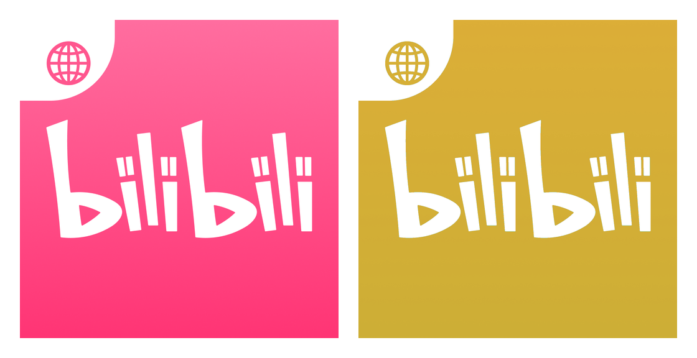
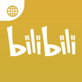
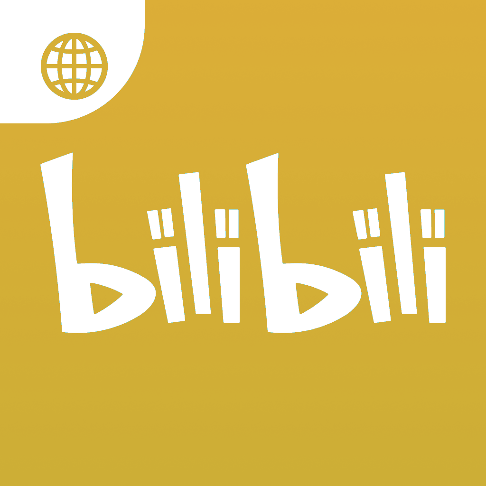

# 应用图标与启动画面

本文记录 App 图标的来源与当前配色（金属金 `#D4AF37`），以及启动画面的相关问题。

## 图标来源与配色

图标不是手绘，而是取自 bilibili 国际版官方 App 资源（App Store bundle id `com.bilibili.inter`，1024×1024），
只改颜色、不改形状：粉红 `#FF417E` 系渐变被替换为**金属金 `#D4AF37`**（RGB 212, 175, 55）。

字形、比例、地球图形、白色区域全部保持原样，未重绘。



*左：bilibili 国际版原始图标，粉红底配白色 bili 字标。右：当前图标，除把粉红换成金属金 `#D4AF37` 外，形状、比例与细节完全一致。*

### 配色为什么不直接平铺

原图并非纯色，而是一层极窄的渐变（均值 `(255, 79.6, 136.7)`）。为了不把渐变抹平成一块死色，
替换时保留了每个像素相对该均值的**小幅偏移**，而不是逐像素统一改写为目标色：

```
目标色 = #D4AF37 + (原像素 - 原图标均值) × k
```

输出校验：主色均值实测 `(211,174,54)`，与目标 `(212,175,55)` 相差 1/255；色相 45.8°。

> 实现见 `tool/recolor_app_icon.py`：色相按圆周均值旋转到金色，饱和度与明度按"目标值 − 当前均值"整体平移，
> 逐像素的细微差异保留下来，所以渐变与抗锯齿边不会被抹平；白色字标、地球高光与透明区域（饱和度低于阈值）完全不动。
>
> 这个脚本同时是**唯一产出途径**：它从 1024 母版重出全部 AppIcon 尺寸、6 张启动图、仓库里的 logo 母版、桌面图标与 `.ico`，
> 避免再出现"母版换了、包里还是旧图"的情况（蓝变金之前就发生过：母版是绿色，包里装的是蓝色）。

## 安装产物核验

图标必须确认已编译进产物，而非只改了源文件。下面是直接从 `Runner.app` 内取出的 120×120 图标：



*从 `Runner.app` 内提取的 120×120 图标，证明金色图标确实进入了构建产物。*

高分辨率母版：



*当前图标的 1024×1024 母版（金属金 `#D4AF37`），所有尺寸由它派生。*

## 覆盖的尺寸

`ios/Runner/Assets.xcassets/AppIcon.appiconset/` 下**全部尺寸都由 1024 母版重出**（20×20 到 1024×1024），
不是只换大图、让小图继续引用旧资源。这一点确实出过问题：母版是绿色的，包里装的却是蓝色的旧图。

## 启动画面

### 无法移除，只能替换

iOS 强制要求提供 launch storyboard（`Info.plist` 的 `UILaunchStoryboardName`），
因此"去除启动动画"在平台层面不可行。改为把它做快、做对：

1. **图标替换** — 启动图原本仍是旧的绿色 "P"，与桌面图标不一致。现同步为新图标。
2. **底色修正** — 启动底色原为纯白，深色主题下会先白闪一下再进 App。已改为纯黑，与 `scaffoldBackgroundColor: Colors.black` 衔接。
3. **图形处理** — 启动图改为圆角 + 透明背景，避免在黑底上出现一块方形蓝块。

### 启动耗时实测

在 `main()` 中加了阶段计时（`_markStartup`），三次冷启动结果一致：

| 阶段 | 耗时 |
| --- | --- |
| binding + mediakit | 起始 |
| appPath | 12 ms |
| storage | 22 ms |
| paths + cache + fonts | 29 ms |
| orientation + locator + pip | 31 ms |
| request-init | 31 ms |

Dart 侧到 `runApp` 仅 **31 ms**。整体冷启动约 2.0–2.6 秒，其余时间花在 Flutter 引擎启动与首帧渲染上，
不在 `main()` 的初始化里。因此进一步压缩启动耗时不能靠裁剪初始化代码。

## 应用名称

`ios/Runner/Info.plist` 中 `CFBundleDisplayName` 与 `CFBundleName` 均为 `bilibili+`。
设备端 `devicectl device info apps` 已确认显示为 `bilibili+`。

Bundle ID 保持 `com.example.pilipalax` 不变。
