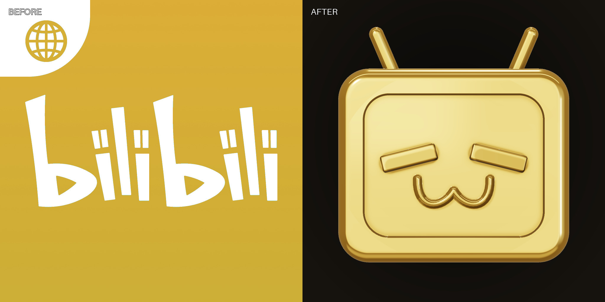
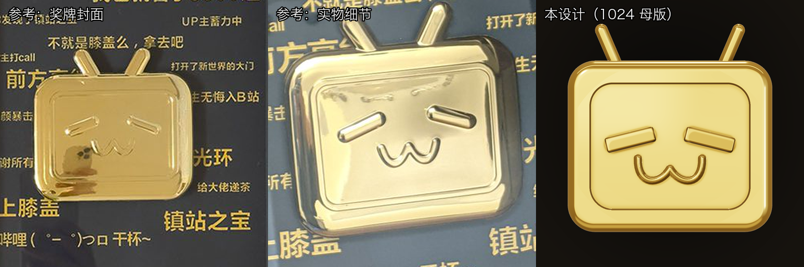
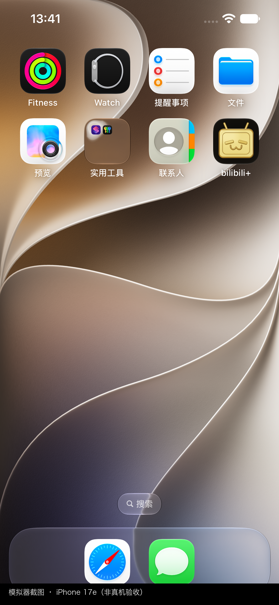
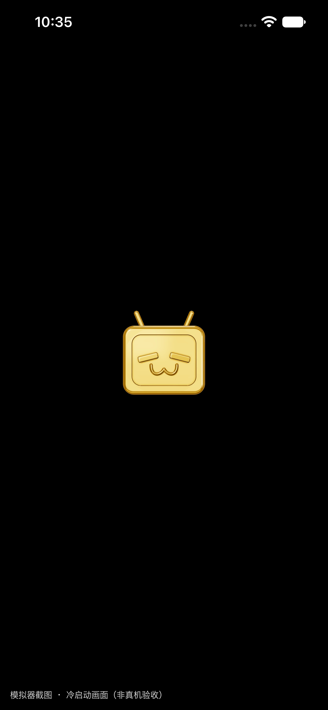
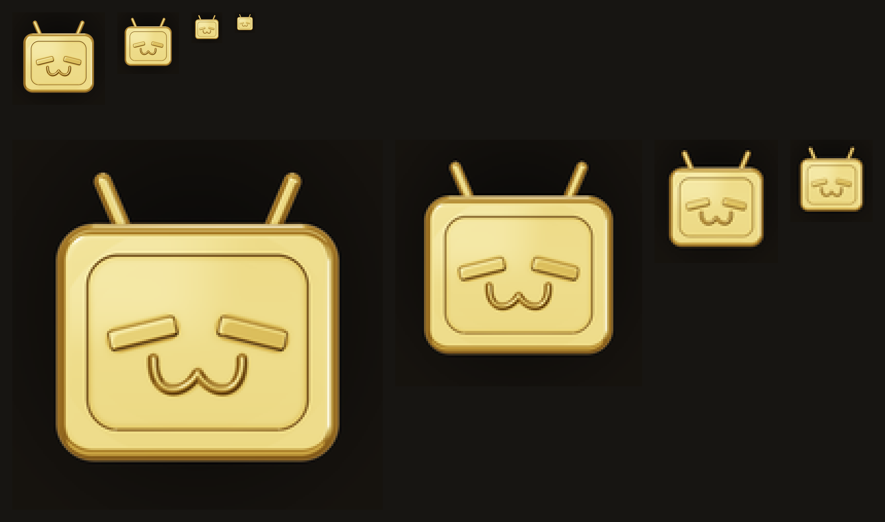
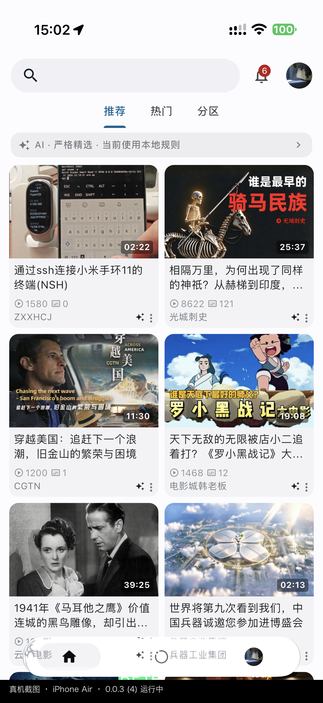

# 应用图标与启动画面

本页记录 **PiliPlus（iOS 显示名 `bilibili+`）** 当前图标的设计来源、生成方式、资源清单与验收结果。

上一版图标是"bilibili 国际版官方图标只换颜色"（金黄色底 + 白色 bilibili 字标 + 左上角地球）。
本次按需求**重新设计**为 B 站百万粉丝纪念奖牌中央的金色小电视，不再保留字标、地球或底色渐变，
也不再使用"对旧图原地换色"的脚本。



*左：旧图标；右：新图标。旧版的金色底色、白色字标与地球角标全部移除。*

## 设计来源

主参考是「大耳朵TV」的百万粉丝奖牌开箱视频：

- 标题：**B站100万粉丝奖牌开箱 & 评测｜大耳朵TV**
- BVID：**BV1afN7zeEJ7**
- 使用部分：奖牌**中央的金色小电视**（不含奖牌底座、粉丝数字、文字与底脚）

辅助实物照片（同一款奖牌的近景）用于校准金属反射与倒角观感。网上另有带底脚、旋钮或不同屏幕比例的
款式，本次**没有**混用它们的结构。



*左：视频封面里的奖牌；中：实物近景（用于材质与倒角）；右：本设计。参考图仅作造型比对，尺寸与布光已按 App 图标重排。*

## 造型

只提取中央小电视，做成独立图标主体：

| 部位 | 处理 |
| --- | --- |
| 机身 | 宽大于高的圆角矩形，约 **1.19 : 1**，四周连续厚倒角 |
| 天线 | 顶部两根短天线，向左上/右上张开，端头圆润，与机身同材质 |
| 屏框 | 内凹的圆角矩形屏面，外围一圈宽边框，边框内侧有连续阴影 |
| 眼睛 | 两段短而粗的圆头金色浮雕条：左眼 `/`、右眼 `\`，约斜 14°，顶面略向光侧俯仰 |
| 嘴巴 | 圆润的双弧 `ω`：两端上翘、中间一个圆峰，细金色浮雕棱 |
| 其余 | 无底脚、无四肢、无旋钮、无扬声器孔、无桂冠/星芒/文字/角标 |

视角接近正交正面（约 11° 等效视场），厚度只靠倒角与少量侧面明暗表达。

## 材质与布光

抛光黄金，金属度 1、粗糙度约 0.13（屏面）/ 0.175（机身）；金属 F0（线性）约
`(1.00, 0.67, 0.235)`。颜色层次用深金、暖金、亮金建立，而不是平铺一个金色：

- 深金反射 `#6B4518`、暗金过渡 `#A77524`、主体暖金 `#D5AC45`、亮金 `#F3D984`、局部高光 `#FFF2CC`；
- 左上方大面积柔光（窗口），右侧较弱补光，顶部窄条轮廓光，地面暖反弹；
- 倒角有窄而亮的反射，曲面和侧边保留受控的深金反射；主面不过曝成白块；
- 屏框与表情根部只有窄阴影，不做黑边；不使用塑料/果冻/金箔/亮粉/拉丝质感。

参考照片里的手机、人物、房间和玻璃反光没有被复制：这里用干净的摄影棚环境替代。

## 生成方式

**没有可用的图像生成模型**，因此没有用扩散模型出图；母版由可编辑的三维几何 + 物理着色渲染器生成，
按需求中的"通过可编辑路径或三维几何校准"执行。所有形状参数都在
`tool/app_icon/render_icon.py` 顶部的常量里，改一个数值即可重渲染，不会随机换一只小电视。

渲染器：SDF 光线步进（机身/天线/眼睛）+ 前表面高度场浮雕（屏面/嘴唇）+ 程序化棚拍环境 +
GGX 直接光 + ACES + sRGB，再做一个很轻的饱和度整理。输出：

```
design/app_icon/master-2048.png          2048×2048，不透明 sRGB 设计母版
design/app_icon/icon-1024.png            1024×1024，iOS 图标设计稿（4× 超采样后落地）
design/app_icon/tv-transparent-1024.png  1024×1024，透明背景金色小电视（启动画面/前景用）
```

构图实测：机身宽 **76.4%** 画布、含天线总高 **78.0%** 画布，水平居中；背景
`#151515` → `#24211C` 的极轻微暖黑变化；四周留白 9%–13%，天线与倒角不贴边。
IOS 图标本身不做圆角裁切，四角完全不透明；系统负责蒙版。

### 可重复的母版 → 派生资源流程

```bash
# 首次：准备带 Pillow + numpy 的 Python 环境（任意 venv 均可）
python3 -m venv /tmp/piliplus-icon-venv
/tmp/piliplus-icon-venv/bin/pip install pillow numpy

# 1) 重渲染设计母版（确定性，无随机数）
/tmp/piliplus-icon-venv/bin/python tool/app_icon/render_icon.py \
  --master design/app_icon/master-2048.png \
  --icon design/app_icon/icon-1024.png \
  --transparent design/app_icon/tv-transparent-1024.png

# 2) 只从母版派生所有工程资源
/tmp/piliplus-icon-venv/bin/python tool/app_icon/build_assets.py
```

`build_assets.py` 每次都从三张母版重新采样，不会读取上一次的派生文件，也不会累积换色或反复缩放。
旧的 `tool/recolor_app_icon.py` 已删除：它把启动图**原地换色**，无法把新造型同步过去。

## 资源清单

| 路径 | 用途 | 规格 |
| --- | --- | --- |
| `ios/Runner/Assets.xcassets/AppIcon.appiconset/*.png` | iOS 桌面图标 | 25 条引用 / 21 个文件，20–1024，PNG sRGB、无 alpha |
| `ios/Runner/Assets.xcassets/LaunchImageGoldTV.imageset/*.png` | iOS 启动图 | 128/256/384（light+dark），RGBA 透明 |
| `assets/images/logo/app_icon_ios_1024.png` | iOS/桌面图标源 | 1024 不透明 |
| `assets/images/logo/app_icon_foreground.png` | Android 自适应前景 | 512 透明，内容收在 66% 安全区 |
| `assets/images/logo/app_icon_monochrome.png` | Android 单色图标 | 512 白色 alpha 蒙版 |
| `assets/images/logo/logo.png` | 关于页图标 | 512 不透明 |
| `assets/images/logo/logo_2.png` | 启动/占位图（透明） | 512 RGBA |
| `assets/images/logo/desktop/logo_large.png` | Linux/macOS 托盘 | 512 不透明 |
| `assets/images/logo/ico/app_icon.ico` | Windows 图标 | 16–256 多尺寸 |

`pubspec.yaml` 的 `flutter_launcher_icons` 已改为指向 1024 母版
（`image_path_ios` / `image_path` / `macos.image_path`），
Android 自适应前景指向安全区版本，背景色 `#151515`。这样后续再跑生成命令不会从旧的
512 桌面图或低分辨率文件反向覆盖本次结果。

## 启动画面

iOS 的 launch storyboard 不能删除，只能替换（`UILaunchStoryboardName`）。本次保持原有布局与背景衔接：

- 尺寸仍是 128/256/384（1x/2x/3x），storyboard 的 `contentMode="center"` 与全屏约束不变；
- 黑色 storyboard 底色不变，与 `scaffoldBackgroundColor: Colors.black` 衔接；
- 图形从旧版"圆角方形图标"改为**同一设计来源的透明金色小电视**，不再有圆角方形底板；
- 浅色/深色两套使用同一张透明素材（启动图本身不铺底色，底色由 storyboard/系统提供）。

### 启动快照缓存

iOS 会把 launch storyboard 的渲染结果缓存到 `SplashBoard`。**只替换 `LaunchImage` 图片、不改变 storyboard
时，系统可能继续显示旧快照**：在已安装 `0.0.3+3` 的设备上，真机仍显示 2.2.0+1 时代的 DeepSeek 蓝图标，
而当前 AppIcon 已经是金色小电视。因此本次：

- 启动图资源从 `LaunchImage` 重命名为 **`LaunchImageGoldTV`**，storyboard 同步更新（启动画面身份改变）；
- build 号从 `+3` 提到 **`0.0.3+4`**，方便区分设备上的新旧构建。

覆盖安装 build 4 后会重新生成启动快照。若个别设备仍显示旧图，删除 App 再重装可清空该缓存
（只影响启动快照，不影响业务数据以外的 App 数据——删除重装会清空本地数据，请自行权衡）。





*以上为 iPhone 17e 模拟器截图，**不是真机验收证据**。真机安装未做。*

## 验收记录

| 检查 | 结果 |
| --- | --- |
| AppIcon 文件与 `Contents.json` | 25 条引用（21 个唯一文件）全部存在，实际像素尺寸逐项匹配（20–1024） |
| 1024 图标颜色模式/透明通道 | `RGB`，`hasAlpha: no`，内嵌 sRGB profile |
| 四角 | 不透明（无透明/白色角），不预裁圆角 |
| 小尺寸 | 180/120/60/40 实测（见下），120 表情清楚，60 仍可辨认金色小电视与天线 |
| 旧字标/地球残留 | 新 AppIcon、启动图、logo、ico 均无白色 bilibili 字标或地球角标 |
| 资源链路可重复 | 两次完整运行母版渲染与资源生成，母版/图标/启动图/ico 的 SHA-256 逐字节一致 |
| 资产目录编译 | `actool` 编译 `Assets.xcassets` 通过，产出 `AppIcon60x60@2x` 等 |
| 编译产物 | `flutter build ios --debug --no-codesign` 成功；`Runner.app` 内 120×120 图标为 RGB、无 alpha、sRGB |
| 模拟器 | iPhone 17e 模拟器安装 0.0.3+4 后桌面图标与冷启动画面正确（见上）；真机未由本会话安装 |



*180/120/60/40 像素的实际大小（上）与 4× 放大（下）。60 像素下脸部仍可辨认，40 像素下轮廓与天线仍清楚，没有糊成黄色方块。*

### 构建产物与模拟器

- `actool` 编译 `Assets.xcassets` 通过；`flutter build ios --debug --no-codesign`
  成功（Xcode build 86.6 s，Flutter 3.47.6）。
- `build/ios/iphoneos/Runner.app` 内 `AppIcon60x60@2x.png`：120×120、RGB、无 alpha、sRGB；
  `Info.plist` 的 `CFBundleDisplayName` 为 `bilibili+`。
- 在 iPhone 17e 模拟器安装后：桌面图标（系统圆角遮罩、天线未裁切）与冷启动画面均正确。
- 本次调试构建启动到主界面时触发了与图标无关的 GetX 断言（当前分支并发改动），
  未在本任务中修改运行时代码；图标与启动图截图不受影响。

## 应用名称

`ios/Runner/Info.plist` 中 `CFBundleDisplayName` 与 `CFBundleName` 仍为 `bilibili+`；
Bundle ID 仍为 `com.example.pilipalax`。本次只改图标资源，不改应用名、Bundle ID 或业务代码。

## 真机验收（iPhone Air，2026-11-06）

使用 `PILIPLUS_DEVELOPMENT_TEAM=8TQDS9JT23 tool/ios_build.sh profile` 构建（Team 8TQDS9JT23，
AV1 VideoToolbox Avcodec 已注入并重签），`devicectl device install app` 覆盖安装到
"Fred的iPhone Ultra🪼"（iPhone Air, iPhone18,4）：

| 检查 | 结果 |
| --- | --- |
| 安装版本 | `bilibili+ 0.0.3 (4)`（`devicectl device info apps`） |
| 冷启动 | `devicectl device process launch` 成功，App 正常运行到推荐页 |
| 启动快照缓存 | `Library/SplashBoard` 下 4 个快照全部重新生成（SHA-256 与旧快照完全不同，时间戳=安装时刻），旧的 DeepSeek 蓝快照已消失 |
| 编译产物 | `Assets.car` 只含 `LaunchImageGoldTV`，不再有旧 `LaunchImage` 条目（`assetutil --info`） |
| 启动画面截图 | **未捕获到**：profile 构建启动过快，`devicectl capture screenshot` 延迟追不上；此设备不支持 `capture screen-record`。快照重建 + 模拟器画面为间接证据 |



*真机截图：iPhone Air 上 0.0.3 (4) 运行中。启动画面本身未被截到（消失快于截图延迟），
其内容以模拟器截图与快照重建记录为准。*

## 未验证项

- **桌面图标与启动画面的真机截图**：设备会自动锁屏，且启动画面消失快于截图延迟；
  解锁状态下主屏图标肉眼可见为金色小电视（本次未留截图）。
- Android 启动器资源（`android/app/src/main/res`）未重新生成：该目录在当前工作区未被 Git 跟踪，
  且本次任务以 iOS 为主。`pubspec.yaml` 的生成配置已指向新的 1024 母版与安全区前景，
  后续运行 `flutter_launcher_icons` 会从新母版生成各平台图标。
- macOS 没有随仓库提交的 AppIcon 资源；配置同样指向新母版。
- Android 启动器资源（`android/app/src/main/res`）未重新生成：该目录在当前工作区未被 Git 跟踪，
  且本次任务以 iOS 为主。`pubspec.yaml` 的生成配置已指向新的 1024 母版与安全区前景，
  后续运行 `flutter_launcher_icons` 会从新母版生成各平台图标。
- macOS 没有随仓库提交的 AppIcon 资源；配置同样指向新母版。

## 冷启动耗时

上一版实测（本次未重复测量）：Dart 侧到 `runApp` 约 31 ms，整体冷启动约 2.0–2.6 s，时间主要花在
Flutter 引擎启动与首帧渲染，不在 `main()` 初始化。该结论与图标替换无关，保留供后续参考。