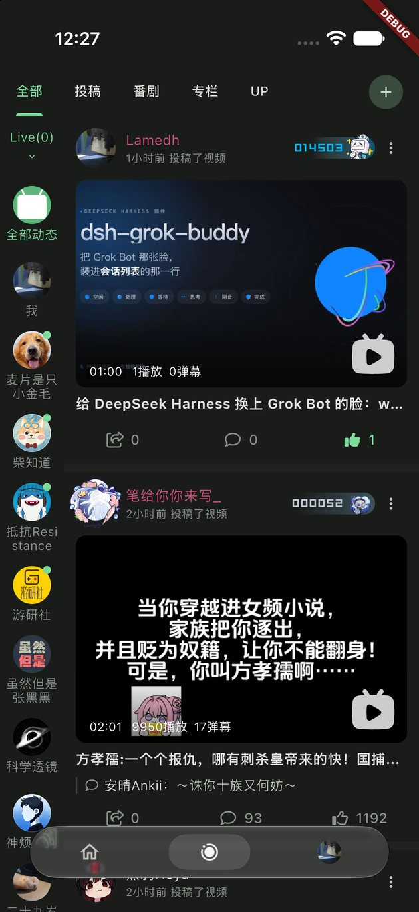

# 液态玻璃底部导航栏

移动端主页底栏是参考录屏里的液态玻璃胶囊：三个入口（首页 / 动态 / 我的）、无文字、图标居中、
选中项背后一块浅色胶囊。页面切换、回顶刷新、动态角标、头像、导航排序与安全区仍由原有控制器负责。

**当前实现（本轮起）**：iOS 26+ 由 UIKit 原生胶囊承载材质（UIVisualEffectView + UIGlassEffect），
Flutter 只负责页面、业务状态、外层布局与无障碍标签；其余平台与低版本系统保留原来的 Flutter
材质作为回退。历史章节保留第一版 shader 实现的记录，它现在只在回退路径上使用。

## 1. 文件与职责

| 文件 | 职责 |
| --- | --- |
| lib/common/widgets/native_liquid_glass_navigation_bar.dart | Dart 桥接：能力查询、状态通道、点击回传、图标栅格化、头像解码、布局 |
| ios/Runner/LiquidGlassNavigationPlugin.swift | 插件注册、viewType、getCapabilities |
| ios/Runner/NativeLiquidGlassNavigationView.swift | 原生胶囊：UIGlassEffect、三个按钮、选中块、角标、无障碍、命中测试 |
| ios/Runner/AppDelegate.swift | 在 didInitializeImplicitFlutterEngine 里注册（与 Pip / Hdr 并列） |
| lib/pages/main/view.dart | 选取原生或回退分支；三入口的数据来源；动态角标 |
| lib/common/widgets/liquid_glass_navigation_bar.dart | 回退用的 Flutter 胶囊（原实现，行为不变） |
| lib/common/widgets/liquid_glass_surface.dart | 回退用的 shader / blur / solid 材质 |
| test/common/native_liquid_glass_nav_bar_test.dart | 桥接测试（稳定 id、增量更新、重复点击、过期头像、销毁） |

这不是完整的系统 UITabBar，而是"用系统玻璃材质的自定义导航容器"：保留无文字、三项等距、
圆形头像与既定胶囊尺寸。没有把页面导航重构成 UITabBarController。

## 2. 原生材质与分支选择

- iOS 26 及以上：UIVisualEffectView 配 UIGlassEffect(style: .clear)，isInteractive = true，
  cornerConfiguration = .capsule()；按钮、图标、头像、选中块都加在 effectView.contentView 里。
  透明位置不补底色，原生视图与祖先 alpha 恒为 1。
- 首轮用 .clear 对齐录屏的通透感；构建时可用 --dart-define=GLASS_STYLE=regular 切到标准玻璃做对照，
  不需要改 Swift。**本轮没有真机，.regular 与 .clear 的可读性对照尚未执行**，只跑过默认的 .clear。
- iOS 26 以下、非 iOS、能力查询失败、平台视图 3 秒内未创建：走 Flutter 回退（第 8 节）。
  回退会打印 [native-glass] Flutter fallback: <reason>；**支持原生的设备不允许静默回退后仍按原生验收**。
- 能力查询在 runApp 之前（lib/main.dart 的启动 Future.wait）完成并缓存，因此首帧不会先画 shader
  再跳成原生。
- 日志：debug 下 [native-glass] capabilities: ... 与 [native-glass] view <id>: {material: ...}；
  material 字段由原生 describe 返回，直接证明当前跑的是 UIGlassEffect 而不是着色器。

## 3. 桥接协议

- 能力通道：piliplus/native_liquid_glass_nav/capabilities，方法 getCapabilities，返回
  supported / effect / osVersion / deviceModel / unsupportedReason 与三项辅助功能开关。
- 实例通道：piliplus/native_liquid_glass_nav/<viewId>，按平台视图 id 隔离。
  Dart→原生：updateState（全量快照 + revision），describe（诊断）。
  原生→Dart：onTap {id}，只回稳定 destinationId。
- 状态字段：items[{id,label,iconKey,selectedIconKey,isAvatar,accessibilityValue,badge{visible,text,isDot}}]、
  selectedId、theme、animate、visible、interactive、pixelRatio、style、avatarToken、avatar、icons{key:png}。
- 不把 Widget 传进 MethodChannel；creationParams 只用于初始化，之后一律走 updateState。
- 稳定 key：平台视图用固定 ValueKey；切换选中、未读、头像只发状态，不重建视图。
- 顺序保护：每次状态带递增 revision，原生丢弃乱序包；创建完成后重发最新状态，并清空"已送图标"集合。
- 发送节流：build 里先算签名（选中项、主题、可见性、角标、图标键、头像 token），只有变化才发；
  图标只在键变化时随状态发送。
- 原生程序性更新选中态（apply）不会回调 onTap；只有真实按钮触摸才会。

## 4. 三个图标与头像

- 首页：Icons.home_outlined / Icons.home_rounded（保留上一轮已确认的设计）。
- 动态：恢复项目原有图标 CustomIcons.motion_photos_on_outlined（0xe80b）/
  CustomIcons.motion_photos_on（0xe80a），来自 lib/models/common/nav_bar_config.dart。
  自绘的 _LiquidDynamicsGlyph / _LiquidDynamicsGlyphPainter 已删除。
- 我的：24pt 圆形账户头像；未登录、face 为空、加载失败时回退 person_rounded 占位。
- 图标位图：Dart 用 FontFamily + codePoint 离屏栅格化（23pt × devicePixelRatio），保持原字形与居中；
  不做页面截图。原生以 alwaysTemplate 渲染跟随前景色；键含字形/尺寸/像素密度，变化才重发。
- 头像：复用 CachedNetworkImageProvider（与 Flutter 头像同一缓存与 provider），PNG 过桥后以
  alwaysOriginal 渲染成圆形，不做单色 tint；token 等于 face URL，异步结果按 token + 请求序号丢弃过期值。
- 角标：数字（>99 显示 99+）、红点、隐藏三态由原生绘制；读屏通过 accessibilityValue 表达未读数。

## 5. 尺寸、安全区与触摸

| 项目 | 值 |
| --- | --- |
| 胶囊 | 高 52，最大宽 360，左右边距 30，圆角 26 |
| 选中块 | 82 × 36，圆角 18；窄屏取 min(82, 单元宽-16) |
| 图标 / 头像 | 23 / 24 |
| 三项 | 均分胶囊内部宽度 |

- 安全区只在 Flutter 计算一次（MainApp 把 viewPadding.bottom 传入），Swift 不读 safeAreaInsets。
- 原生平台视图的 frame 就是胶囊本身；外侧边距与底部留白是 Flutter 的布局。
- 命中测试按胶囊圆角路径裁剪：四个透明圆角与胶囊之外都返回 nil，正文可以继续点击/滚动；
  UiKitView 用 translucent，避免整块区域吞掉手势。
- 三个按钮各自完整可点、互不重叠；Flutter 侧没有同位置的手势，一次点击只会有一次业务响应。
- 选中块用 CABasicAnimation 动画 position.x，起点读取 presentation layer，快速连点从当前位置继续；
  减少动态效果时直接落位。按压反馈是图标 0.9 缩放，与选中动画分开。
- 键盘弹出时整条底栏不参与布局、命中与语义；隐藏时原生同步 visible=false 并关闭无障碍暴露。

## 6. 兼容与无障碍

- 沿用既有 liquidGlassNavBar 偏好，没有新增产品开关。
- 降低透明度：原生把材质换成不透明系统底色（与系统自身行为一致），不强行恢复透明。
- 提高对比度：提高图标不透明度、选中块对比与描边。
- 减少动态效果：选中块不做位移动画。
- VoiceOver：每项是按钮、标签为首页/动态/我的，选中项带 selected；未读数放在 accessibilityValue。
  原生视图是唯一语义来源，Flutter 侧不再产生第二套节点（回退分支才由 Flutter 提供语义）。

## 7. 本轮验证

| 项目 | 结果 |
| --- | --- |
| Dart 静态分析 | dart analyze 改动文件：0 issue |
| 组件/桥接测试 | flutter test 两个底栏测试文件 20/20 通过（新增 8 条桥接用例） |
| iOS 构建（无签名） | flutter build ios --debug --no-codesign 通过 |
| iOS 构建（签名） | tool/ios_build.sh debug，Team 8TQDS9JT23，产物已签名 |
| 模拟器 | iPhone Air（420×912）iOS 27.2：确认走原生分支（日志 material: UIGlassEffect.clear）；胶囊/选中块/图标/头像位置按像素测量与 Flutter 布局一致（胶囊 30→390pt、底 878pt、选中块 82×36）；深色/浅色截图；角标 5 / 99+ / 红点 / 隐藏；头像清空后回落到人形占位；setIndex 切换后选中块与内容同步 |
| 真机材质 | **已验证**：iPhone Air（iPhone18,4）iOS 27.3 24C5037i，profile 签名包（Team 8TQDS9JT23）。启动日志 [native-glass] material=UIGlassEffect.clear os=27.3 reduceTransparency=false reduceMotion=false |
| 真机点击 | **已验证**：手动点「动态」「我的」「首页」，选中块与页面跟随；再点当前项触发回顶/刷新（用户操作，非脚本） |
| 真机背景采样 | **已验证**：滚动时连续截图，胶囊内部平均亮度随下方内容在 111→235→252→118 间变化；停止滚动后连续 9 帧完全一致（0 变化），说明是实时采样而不是静态白底 |
| 真机遮挡 | **已验证**：进入视频详情页后胶囊消失，返回主页面后恢复 |
| 深色真机 | **未验证**：设备当前为浅色；只能给模拟器深色证据 |
| VoiceOver / 降低透明度 / 提高对比度 / 减少动态 | **未验证**：没有改设备辅助功能设置（按要求不改系统设置），只做了代码路径与模拟器检查 |
| 性能 | **未测**：xctrace 把该设备列为 "Devices Offline"，lldb/Instruments 通道同样不可用；没有真机帧耗时、掉帧与内存数据，不把构建通过当作帧率达标 |

模拟器证据（均取自整屏截图，不是单张 UIVisualEffectView 快照）：
images/liquid-glass/native-dark-dynamics.jpg、native-light-dynamics.jpg、native-badge-99.jpg、
native-avatar-fallback.jpg、native-selected-mine.jpg。

## 8. 回退实现（历史记录）

第一版材质完全在 Flutter 内完成，现仅作为回退：

1. BackdropFilter + ImageFilter.shader 实时采样已绘制背景，不截图、不 toImage；
   ImageFilter.compose(outer: shader, inner: blur)，uniform 在 paint 阶段按 localToGlobal 写入。
2. 轮廓：shader 内胶囊 SDF，法线用中心差分，band=13pt 环带向外位移最多 9pt，中心 1.5% 放大。
3. 合成：深色黑色 tint 0x5E→0x45，浅色白色 0x8A→0x66，1pt 边缘高光 + 1.2px 内发光。
4. 选中块 82×36、圆角 18 的半透明填充，无第二层折射。

运行模式（日志 [liquid-glass] render mode: ...）：refraction / blur / solid；solid 由 highContrast
触发。Flutter 没有暴露 iOS「降低透明度」平台标志，回退分支只处理 highContrast 与 disableAnimations。

## 9. 与参考的差异、未验证事项

- 入口 4 → 3：视频第 3 项「＋」按要求删除，三项等距重排；不做整图像素相等比较。
- 视频只展示首页选中与列表滚动；切换动画、按压反馈是补齐的设计。
- 按压反馈（isInteractive 与按钮 0.9 缩放）只编译验证过，没有真机触摸证据。
- 视频只有深色背景；浅色是同结构适配，没有参考可对照。
- **真机已确认**：走的是 UIGlassEffect、点击可用、背景实时采样、详情页遮挡正常。
  **仍未验证**：深色主题下的真机表现、按压动效的体感、VoiceOver、降低透明度/提高对比度、
  键盘弹出、旋转、前后台恢复、内存与帧率。
- 本机 flutter run（debug）在该设备上会停在 Installing and launching 并报
  OS Error: Can't assign requested address, errno = 49（lldb 调试通道问题）；真机验收改走
  profile 包 + devicectl 启动，日志来自 devicectl 的 --console。
- 模拟器上滚动时胶囊内像素变化很小（深色列表内容接近均匀），无法据此判断材质实时性；必须用真机
  录屏确认，不能用模拟器结果替代。
- 验收时首页出现 [Get] improper use of a GetX 红屏：与底栏无关（回退分支同样出现），来自工作区里
  并发的首页推荐流改动；本轮未修改这些文件。

## 10. 真机验收步骤（待设备可用后执行）

    PILIPLUS_DEVELOPMENT_TEAM=8TQDS9JT23 bash tool/ios_build.sh profile
    xcrun devicectl device install app --device <UDID> build/ios/iphoneos/Runner.app
    xcrun devicectl device process launch --console --terminate-existing \
        --device <UDID> com.example.pilipalax
    xcrun devicectl device capture screen-record --device <UDID> \
        --destination nav.mp4 --duration 30
    xcrun devicectl device capture screenshot --device <UDID> --destination nav.png

启动后用控制台里的 [native-glass] material=UIGlassEffect.clear 判断是否原生；没有这行就是回退，
不能按原生通过。debug 包在本机目前无法用 flutter run 启动（见第 9 节），profile 包可以直接启动。
