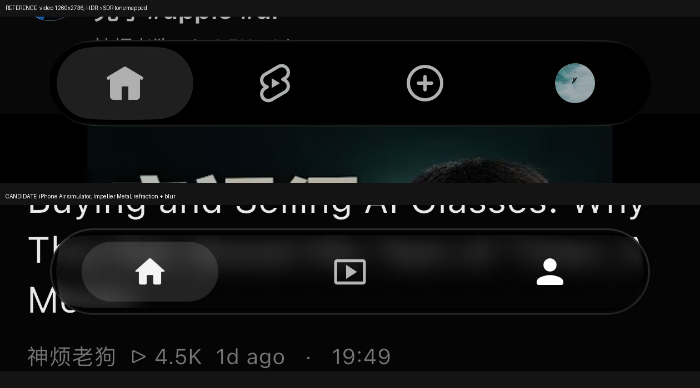

# 液态玻璃底部导航栏

移动端主页底栏改为参考录屏中的液态玻璃胶囊：三个入口（首页 / 动态 / 我的）、无文字、
图标居中、选中项背后一块浅色胶囊。页面切换、回顶刷新、动态角标、头像、导航排序与安全区
仍由原有控制器负责。

## 1. 入口与接入点

- 组件：`lib/common/widgets/liquid_glass_navigation_bar.dart`（布局 / 三入口 / 选中块 / 点击 / 语义）
- 材质：`lib/common/widgets/liquid_glass_surface.dart`（shader 加载、能力检测、降级、生命周期）
- 着色器：`assets/liquid_glass/liquid_nav.frag`（单胶囊背景折射，`pubspec.yaml` 的 `shaders:` 声明）
- 接入：`lib/pages/main/view.dart` 的 `_bottomNav`，仅 `useBottomNav` 分支；侧栏 / NavigationRail /
  平板侧边导航完全不变。页面仍由原来的 PageView / TabBarView + MainController 管理。

着色器没有放在 `assets/shaders/`：该目录是播放器 GLSL 的普通资源目录，Flutter 工具会拒绝
把 `shaders:` 中声明的文件同时当作普通资源打包（`Shader ... is included in the asset directory`）。

## 2. 材质实现

1. `BackdropFilter` + `ImageFilter.shader` 实时采样已绘制的背景，不截图、不 toImage、不复制页面。
   滤波器为 `ImageFilter.compose(outer: shader, inner: blur)`：先低估模糊、再按轮廓位移采样。
   `u_size`（引擎写入的输入纹理尺寸）与首个 sampler 由引擎提供，其余 uniform 在 paint 阶段按
   `localToGlobal` 的实际绘制变换写入，不使用 GlobalKey 或 post-frame 回调。
2. 轮廓：着色器内胶囊 SDF；中心差分得到法线；`band=13pt` 的环带内按 `(1-内距/band)^2` 向外
   位移最多 `9pt`，中心只做 `1.5%` 轻微放大。上下缘因此出现参考中的压缩/拉伸。
   GLES 后端按官方约定翻转 y。
3. 合成（普通 Flutter 绘制，清晰、不参与折射）：深色模式黑色 tint `0x5E→0x45` 自顶向下渐变；
   浅色模式白色 `0x8A→0x66`；1pt 边缘高光（白 `0.15/0.11`，浅色 `0.6/0.5`）加 1.2px 模糊内发光。
   深色背景上的近黑外观来自「背景 × tint」，不是不透明黑。
4. 选中块：82×36、圆角 18 的普通半透明填充（深色白 12%，浅色黑 8%），没有第二层背景折射；
   在其上再画图标与头像，保证图标清晰。

运行模式（日志 `[liquid-glass] render mode: ...`，仅 debug）：

| 模式 | 条件 | 表现 |
| --- | --- | --- |
| refraction | Impeller（`ImageFilter.isShaderFilterSupported`）且 shader 加载成功 | 完整折射 + 低模糊 |
| blur | 非 Impeller、shader 资源失败、首帧未加载完 | 同样的胶囊、tint、高光与交互，普通背景模糊 |
| solid | `MediaQuery.highContrastOf` 为真 | 实色填充，保证可读 |

Flutter 没有暴露 iOS「降低透明度」平台标志，只有 `highContrast` 与 `disableAnimations`；
本轮没有为此新增平台桥接。

## 3. 几何（视频实测 → 采用值）

视频 1260×2736、60fps、HEVC Main10 / BT.2020 / PQ。抽帧用 numpy 做 PQ EOTF → BT.2020→709 → SDR
色调映射后测量，未修改原始文件。按 3× 折算（iPhone Air 逻辑尺寸 420×912）：

| 项目 | 视频实测 | 实现 |
| --- | --- | --- |
| 外壳 | 360.3 × 52.7，圆角 26.3 | 360 × 52，圆角 26 |
| 左右边距 | 29.7 / 30 | 30 |
| 外壳底距屏底 | 33.3 | `max(viewPadding.bottom, 12)`，iPhone Air 上为 34 |
| 选中块 | 81.7 × 36，圆角 18 | 82 × 36，圆角 18 |
| 首页图标 | 22 × 20 | 23 图标框（glyph ≈20） |
| 第二图标 | 18 × 22.7（竖长圆角菱形 + 播放三角） | 本地矢量绘制，同比例 |
| 我的头像 | 24 × 24 | 24 |
| 边缘高光 | 峰值 ≈0.165 白，1pt | 1pt，深色 0.15/0.11 |

三项布局：外壳宽度不变，三个交互区等宽（420 屏上 120pt），选中块保持 82pt 不拉满，
窄屏时取 `min(82, 单元宽-16)`。安全区只计一次：MainApp 把 `_padding.bottom` 显式传入，
组件内部不再套 SafeArea（该子树已被 `MediaQuery.removePadding` 清空）。

## 4. 偏好与兼容

- `liquidGlassNavBar`（`storage_key` / `storage_pref`），移动端默认开启，优先于
  `floatingNavBar` 与 `enableMYBar`；设置页「液态玻璃底栏」写明了这个优先级，另外两项的
  副标题也标注了「仅在关闭后生效」，默认值与 `Pref` 读取逻辑一致。
- `hideBottomBar` 默认在移动端为 true，但玻璃模式沿用录屏中「常驻」的行为：
  只有用户**从未保存过**该开关时才忽略默认值；显式保存过的值（开或关）仍然生效，
  收起方式继续沿用 instant / sync 两种原有模式。判断依据是 Hive 的 `containsKey`，不改写用户存储。
- 关闭方法：设置 → 样式设置 → 关闭「液态玻璃底栏」，即恢复原来的悬浮底栏 / MD3 底栏 /
  经典底栏选择；或直接把 `liquidGlassNavBar` 写回 false。
- `liquidGlassNavBar` 已加入备份注册的 general 分类。

## 5. 交互

- 点击仍调用 `MainController.setIndex`，触觉反馈只在控制器里触发一次，底栏不重复。
- 同页重复点击的回顶 / 刷新、默认页、返回键、导航排序与显隐、动态角标清除、账户切换头像
  全部沿用原逻辑；入口按 `navigationBars` 实际顺序生成，不硬编码「索引 1 是动态」。
- 选中块 280ms `easeOutCubic` 平移，快速连点从当前位置改向；`disableAnimations` 时立即落到目标。
  按压反馈只是图标 0.9 缩放，没有新增拖动选页或长按菜单。
- 键盘弹出时整条底栏不参与布局、命中与语义；完全隐藏（instant/sync）时同样的处理。
- 外侧留白不吞事件：只有胶囊内部的三块交互区响应，透明区域交给正文。

## 6. 验证记录

| 项目 | 结果 |
| --- | --- |
| 静态检查 | `dart analyze lib test`：0 error，改动文件 0 issue；其余 150 条 info 为既有代码。`flutter analyze`（LSP）在本机崩溃（`analysis server exited with code 255`，JSON 解析异常），属工具环境问题，改用 `dart analyze` |
| 单元/组件测试 | `flutter test test/common/` 22/22 通过（新增 12 条：回调与选中同步、快速连点、重排/隐藏/单入口、角标与头像占位、降级、420×912 inset 34 组合 MainLayout 几何、无 inset/小屏/uiScale、空白不吞点击、键盘隐藏、reduce motion、语义） |
| 构建 | iOS 模拟器 debug 构建并实际运行（Impeller Metal，日志 `render mode: refraction`）；release / no-codesign 构建见提交说明 |
| 模拟器 | iPhone Air（420×912，与录屏同逻辑尺寸）深色 / 浅色截图、材质与降级对照 |
| 真机 | **未验证**：本轮没有可连接的 iPhone（`flutter devices` 只有 macOS 与 Chrome；无线设备不可达）。所有「真机」结论均为未验证 |
| 性能 | **未测**：没有脚本化滚动/切换的计时数据，不把编译成功当作帧率达标 |
| 与参考的视觉对照 | 外壳位置、宽高、圆角、图标与头像中心、选中块尺寸、边缘高光峰值已按像素测量对齐（误差 ≤1–2pt）；材质方向与强度按同背景截图目视校准 |

对照图：`images/liquid-glass/reference-nav.png`（参考）、`candidate-nav.png`（候选）、
`app-dark.png`（真实 app 内深色）。

## 7. 已知差异 / 未验证事项

- 入口 4 → 3：视频第 3 项「＋」按要求删除，其余三项等距重排，外壳宽度与选中块尺寸保持不变；
  因此不做整图像素相等比较。
- 视频只展示首页选中与列表滚动，没有展示点击切换、选中块滑动、长按；切换动画、按压反馈属于
  补齐的设计，不是视频观察到的要求。
- 视频只提供深色背景；浅色模式是同结构适配，没有参考可对照。
- 模糊强度、tint 比例是目视校准值（视频没有可测的纯色背景做定量反解）。
- 真机、120Hz 帧预算、横竖屏切换、uiScale 的真机表现、后台恢复、真机键盘与弹层均为未验证。
- 验收时 app 首页出现 `[Get] the improper use of a GetX` 红屏：把本任务改动整体 stash 后
  同一红屏仍出现（旧 MD3 底栏），说明来自工作区里并发的首页推荐流改动，与本功能无关，
  本轮未修改这些文件。
